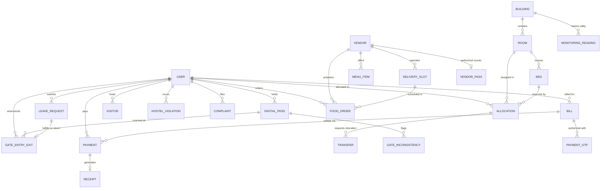

# 4. Database Design and Schema Specification

## 4.1 Database Architecture Overview

The persistence tier of **SmartStay** is powered by **MongoDB**, an open-source, document-oriented NoSQL database system, interfaced through the **Mongoose ODM v9.11.2** query and modeling library. 

Data entities are maintained across **24 distinct collections**. While MongoDB is inherently schema-flexible, SmartStay enforces strict type safety, field validations, enum constraints, reference integrity, and automated timestamp tracking (`createdAt`, `updatedAt`) at the application layer through Mongoose Schema definitions. Relational links across collections utilize standard 12-byte BSON `ObjectId` references (`mongoose.Schema.Types.ObjectId`), resolving joined data structures on demand using Mongoose population (`.populate()`).

---

## 4.2 Entity Relationship Diagram (ERD)

The following Mermaid Entity-Relationship diagram maps the structural linkages, foreign key references, and relational cardinality across all 24 Mongoose models.

---

## 4.3 Detailed Schema Specifications by Domain

### 4.3.1 Domain 1: Hostel Infrastructure & Room Allocation

#### 1. `Building` Model (`Building.js`)
* **Collection Name**: `buildings`
* **Purpose**: Represents physical hostel blocks and administrative buildings within the campus.
* **Fields**:
  - `_id` (`ObjectId`, PK): Auto-generated unique identifier.
  - `name` (`String`, required): Name of the building (e.g., "Block A", "Block B").
  - `code` (`String`, required, unique): Short alphanumeric code (e.g., "BLK-A").
  - `address` (`String`): Campus address location.
  - `floors` (`Number`, required): Total number of habitable floors.
  - `description` (`String`): Descriptive metadata.
  - `isActive` (`Boolean`, default: `true`): Operational flag.
  - `createdAt`, `updatedAt` (`Date`): Timestamps.

#### 2. `Room` Model (`Room.js`)
* **Collection Name**: `rooms`
* **Purpose**: Defines individual dormitory rooms within a building block.
* **Fields**:
  - `_id` (`ObjectId`, PK): Unique room record identifier.
  - `buildingId` (`ObjectId`, ref: `Building`, required): Foreign key to host building.
  - `roomNumber` (`String`, required): Room door identifier (e.g., "101", "204").
  - `floor` (`Number`, required): Floor level.
  - `capacity` (`Number`, required): Maximum student occupant capacity (e.g., 2, 4).
  - `roomType` (`String`, enum: `['Standard', 'Deluxe', 'Shared', 'Single']`, default: `'Standard'`): Room specification.
  - `status` (`String`, enum: `['Available', 'Occupied', 'Maintenance']`, default: `'Available'`): Real-time occupancy state.
  - `isActive` (`Boolean`, default: `true`): Availability flag.
  - `createdAt`, `updatedAt` (`Date`): Timestamps.

#### 3. `Bed` Model (`Bed.js`)
* **Collection Name**: `beds`
* **Purpose**: Granular per-bed tracking within dormitory rooms.
* **Fields**:
  - `_id` (`ObjectId`, PK): Unique bed identifier.
  - `roomId` (`ObjectId`, ref: `Room`, required): Foreign key linking bed to its parent room.
  - `bedNumber` (`String`, required): Identifier within the room (e.g., "B1", "B2").
  - `status` (`String`, enum: `['Available', 'Occupied', 'Maintenance']`, default: `'Available'`): Current occupancy state.
  - `isActive` (`Boolean`, default: `true`): Availability flag.
  - `createdAt`, `updatedAt` (`Date`): Timestamps.

#### 4. `Allocation` Model (`Allocation.js`)
* **Collection Name**: `allocations`
* **Purpose**: Formal lease/room allocation contracts linking a student to a specific bed and room.
* **Fields**:
  - `_id` (`ObjectId`, PK): Unique allocation contract identifier.
  - `studentRegistrationId` (`String`, required): Student registration number.
  - `studentName` (`String`, required): Student legal name.
  - `roomId` (`ObjectId`, ref: `Room`, required): Reference to assigned room.
  - `bedId` (`ObjectId`, ref: `Bed`, required): Reference to reserved bed.
  - `allocationDate` (`Date`, default: `Date.now`): Contract start timestamp.
  - `status` (`String`, enum: `['Active', 'Pending', 'Checked Out']`, default: `'Pending'`): Contract status.
  - `notes` (`String`): Administrative remarks.
  - `createdAt`, `updatedAt` (`Date`): Timestamps.

#### 5. `Transfer` Model (`Transfer.js`)
* **Collection Name**: `transfers`
* **Purpose**: Manages student room change and bed relocation requests.
* **Fields**:
  - `_id` (`ObjectId`, PK): Unique transfer petition identifier.
  - `allocationId` (`ObjectId`, ref: `Allocation`, required): Existing active allocation.
  - `studentRegistrationId` (`String`, required): Requesting student ID.
  - `fromRoomId` (`ObjectId`, ref: `Room`, required): Current room reference.
  - `fromBedId` (`ObjectId`, ref: `Bed`, required): Current bed reference.
  - `toRoomId` (`ObjectId`, ref: `Room`, required): Target destination room reference.
  - `toBedId` (`ObjectId`, ref: `Bed`, required): Target destination bed reference.
  - `reason` (`String`, required): Justification statement.
  - `reasonCategory` (`String`): Category (Medical, Academic, Interpersonal, Maintenance).
  - `urgency` (`String`, enum: `['Normal', 'High', 'Critical']`, default: `'Normal'`): Priority flag.
  - `contactPhone` (`String`): Student contact number.
  - `additionalNotes` (`String`): Student notes.
  - `wardenNotes` (`String`): Administrative evaluation remarks.
  - `status` (`String`, enum: `['Pending', 'Approved', 'Rejected']`, default: `'Pending'`): Approval state.
  - `reviewedAt` (`Date`): Timestamp of administrative decision.
  - `createdAt`, `updatedAt` (`Date`): Timestamps.

---

### 4.3.2 Domain 2: Student Security, Digital Pass & Gate Movement

#### 6. `User` Model (`User.js`)
* **Collection Name**: `users`
* **Purpose**: Primary identity and authentication model for all system personas.
* **Fields**:
  - `_id` (`ObjectId`, PK): Unique user record identifier.
  - `name` (`String`, required): Full user name.
  - `email` (`String`, required, unique): System login email address.
  - `passwordHash` (`String`, required, select: `false`): Bcrypt salted password hash.
  - `role` (`String`, required, enum: `['student', 'admin', 'hostel_admin', 'warden', 'security', 'security_officer', 'maintenance', 'maintenance_staff', 'finance', 'finance_staff', 'vendor', 'delivery', 'delivery_person', 'executive']`): System role.
  - `accountStatus` (`String`, enum: `['active', 'suspended', 'inactive', 'pending']`, default: `'active'`): Operational status.
  - `registrationNumber` (`String`): Academic student index / staff identity code.
  - `studentId` (`String`): Duplicate student ID reference for search flexibility.
  - `room` (`String`): Allocated room tag.
  - `building` (`String`): Allocated building tag.
  - `phone` (`String`): Contact phone number.
  - `createdAt`, `updatedAt` (`Date`): Timestamps.

#### 7. `DigitalPass` Model (`DigitalPass.js`)
* **Collection Name**: `digitalpasses`
* **Purpose**: Cryptographic smart pass credentials representing student authorization to enter/exit hostel premises.
* **Fields**:
  - `_id` (`ObjectId`, PK): Unique pass record identifier.
  - `student` (`ObjectId`, ref: `User`, required): Reference to passholder user.
  - `studentRegistrationId` (`String`, required): Student registration code.
  - `studentName` (`String`, required): Full student name.
  - `passNumber` (`String`, required, unique): Human-readable pass code (e.g., `PASS-2026-001`).
  - `tokenHash` (`String`, required): Cryptographic hash verifying pass authenticity.
  - `qrToken` (`String`): Dynamic encoded payload string rendered by the QR canvas.
  - `validFrom` (`Date`, default: `Date.now`): Pass validity commencement.
  - `validUntil` (`Date`, required): Pass validity expiration timestamp.
  - `status` (`String`, enum: `['Active', 'Suspended', 'Revoked', 'OnLeave']`, default: `'Active'`): State.
  - `room` (`String`): Student room number.
  - `building` (`String`): Student building block.
  - `issuedBy` (`ObjectId`, ref: `User`): Issuing warden/admin user reference.
  - `lastScannedAt` (`Date`): Timestamp of most recent gate interaction.
  - `lastMovementDirection` (`String`, enum: `['IN', 'OUT', 'NONE']`, default: `'NONE'`): Prior logged direction.
  - `lastOperationId` (`String`): UUID of the most recent atomic gate transaction.
  - `hasInconsistency` (`Boolean`, default: `false`): Flag indicating consecutive motion anomaly.
  - `remarks` (`String`): Security notes.
  - `createdAt`, `updatedAt` (`Date`): Timestamps.

#### 8. `GateEntryExit` Model (`GateEntryExit.js`)
* **Collection Name**: `gateentryexits`
* **Purpose**: Immutable ledger recording all physical student movements across perimeter turnstiles.
* **Fields**:
  - `_id` (`ObjectId`, PK): Unique movement event identifier.
  - `student` (`ObjectId`, ref: `User`, required): Reference to moving student.
  - `studentRegistrationId` (`String`, required): Registration code.
  - `studentName` (`String`, required): Student name.
  - `pass` (`ObjectId`, ref: `DigitalPass`, required): Reference to scanned pass.
  - `passNumber` (`String`, required): Scanned pass number.
  - `direction` (`String`, enum: `['IN', 'OUT']`, required): Movement vector.
  - `gateName` (`String`, required): Specific physical checkpoint (e.g., "Main Gate", "North Turnstile").
  - `scannedBy` (`ObjectId`, ref: `User`, required): Security officer user reference.
  - `officerName` (`String`): Security officer name.
  - `timestamp` (`Date`, default: `Date.now`): Exact timestamp of gate clearance.
  - `isCurfewBreach` (`Boolean`, default: `false`): True if logged past hostel curfew (22:00).
  - `leaveRequest` (`ObjectId`, ref: `LeaveRequest`): Linked approved leave authorization, if applicable.
  - `operationId` (`String`): Unique transaction UUID for atomic reconciliation.
  - `leaveCompletionStatus` (`String`, enum: `['NONE', 'PENDING', 'COMPLETED', 'FAILED']`, default: `'NONE'`): Status of leave closure.
  - `curfewViolationStatus` (`String`, enum: `['NONE', 'PENDING', 'CREATED', 'FAILED']`, default: `'NONE'`): Automated violation filing status.
  - `reconciliationNotes` (`String`): Recovery notes if recovery pipeline was executed.
  - `remarks` (`String`): Gate officer observations.
  - `createdAt`, `updatedAt` (`Date`): Timestamps.

#### 9. `GateInconsistency` Model (`GateInconsistency.js`)
* **Collection Name**: `gateinconsistencies`
* **Purpose**: Audit log recording anomalous movement events (e.g. repeated IN without OUT, tailgating, scanning expired credentials).
* **Fields**:
  - `_id` (`ObjectId`, PK): Unique inconsistency incident ID.
  - `pass` (`ObjectId`, ref: `DigitalPass`, required): Targeted pass reference.
  - `passNumber` (`String`, required): Pass identifier code.
  - `student` (`ObjectId`, ref: `User`): Flagged student reference.
  - `operationId` (`String`, required): Failed transaction UUID.
  - `failedOperation` (`String`, required): Operation descriptor (e.g., "GATE_RECORD_OUT").
  - `attemptedDirection` (`String`, enum: `['IN', 'OUT']`): Vector that failed validation.
  - `reason` (`String`, required): Human-readable reason for system rejection.
  - `passStateAtFailure` (`Mixed`): Snapshot of pass document state at rejection time.
  - `resolved` (`Boolean`, default: `false`): Security investigation closure flag.
  - `resolvedAt` (`Date`): Timestamp of administrative resolution.
  - `resolutionNotes` (`String`): Warden resolution findings.
  - `createdAt`, `updatedAt` (`Date`): Timestamps.

#### 10. `LeaveRequest` Model (`LeaveRequest.js`)
* **Collection Name**: `leaverequests`
* **Purpose**: Student overnight leave, vacation, and weekend absence applications.
* **Fields**:
  - `_id` (`ObjectId`, PK): Unique leave application identifier.
  - `student` (`ObjectId`, ref: `User`, required): Applicant student reference.
  - `studentRegistrationId` (`String`, required): Student ID.
  - `studentName` (`String`, required): Applicant name.
  - `departureDate` (`Date`, required): Scheduled date and time of departure.
  - `expectedReturnDate` (`Date`, required): Scheduled return deadline.
  - `actualReturnDate` (`Date`): Recorded timestamp of return through the security gate.
  - `reason` (`String`, required): Reason for leave (Medical, Family, Academic).
  - `destination` (`String`, required): Destination city/address.
  - `emergencyContact` (`String`, required): Parent/guardian phone number.
  - `status` (`String`, enum: `['Pending', 'Approved', 'Rejected', 'Completed']`, default: `'Pending'`): Approval state.
  - `approvedBy` (`ObjectId`, ref: `User`): Approving warden user reference.
  - `approverName` (`String`): Approving warden name.
  - `reviewedAt` (`Date`): Timestamp of review.
  - `wardenRemarks` (`String`): Warden evaluation notes.
  - `createdAt`, `updatedAt` (`Date`): Timestamps.

#### 11. `Visitor` Model (`Visitor.js`)
* **Collection Name**: `visitors`
* **Purpose**: Records external visitors, visiting relatives, and campus contractors.
* **Fields**:
  - `_id` (`ObjectId`, PK): Unique visitor record identifier.
  - `visitorName` (`String`, required): Visitor legal name.
  - `nicOrPassport` (`String`, required): National Identity Card (NIC) or Passport number.
  - `contactNumber` (`String`, required): Mobile phone number.
  - `student` (`ObjectId`, ref: `User`, required): Reference to host student.
  - `studentRegistrationId` (`String`, required): Host student ID.
  - `studentName` (`String`, required): Host student name.
  - `relationship` (`String`, enum: `['Parent', 'Guardian', 'Sibling', 'Academic Colleague', 'Other']`, required): Relationship to host.
  - `purpose` (`String`, required): Statement of visiting purpose.
  - `entryTime` (`Date`): Checked-in entry timestamp.
  - `exitTime` (`Date`): Checked-out exit timestamp.
  - `status` (`String`, enum: `['Expected', 'Checked-In', 'Checked-Out', 'Denied']`, default: `'Expected'`): Gate clearance state.
  - `gateName` (`String`): Checkpoint location.
  - `gateOfficer` (`ObjectId`, ref: `User`): Logging officer user reference.
  - `officerName` (`String`): Officer name.
  - `remarks` (`String`): Security notes.
  - `createdAt`, `updatedAt` (`Date`): Timestamps.

#### 12. `HostelViolation` Model (`HostelViolation.js`)
* **Collection Name**: `hostelviolations`
* **Purpose**: Disciplinary incident tracking, curfew breaches, and fine administration.
* **Fields**:
  - `_id` (`ObjectId`, PK): Unique disciplinary file identifier.
  - `student` (`ObjectId`, ref: `User`, required): Offending student user reference.
  - `studentRegistrationId` (`String`, required): Student registration code.
  - `studentName` (`String`, required): Student name.
  - `violationType` (`String`, enum: `['Curfew Breach', 'Unauthorized Visitor', 'Noise Disturbance', 'Property Damage', 'Prohibited Items', 'Sub-letting', 'Other']`, required): Infraction classification.
  - `severity` (`String`, enum: `['Minor', 'Moderate', 'Major', 'Critical']`, default: `'Minor'`): Severity weight.
  - `description` (`String`, required): Factual incident report.
  - `incidentDate` (`Date`, default: `Date.now`): Timestamp of occurrence.
  - `location` (`String`): Campus scene location.
  - `reportedBy` (`ObjectId`, ref: `User`, required): Reporting officer or warden user reference.
  - `reporterName` (`String`): Reporter name.
  - `reportedByRole` (`String`): Role of reporter (Security, Warden, Sub-Warden).
  - `fineAmount` (`Number`, default: `0`): Imposed monetary penalty in LKR.
  - `fineStatus` (`String`, enum: `['None', 'Pending', 'Paid', 'Waived']`, default: `'None'`): Settlement status.
  - `status` (`String`, enum: `['Pending', 'Under Investigation', 'Resolved', 'Dismissed']`, default: `'Pending'`): Disciplinary file status.
  - `actionTaken` (`String`): Formal sanction or warning applied.
  - `resolvedAt` (`Date`): Timestamp of case closure.
  - `resolvedBy` (`ObjectId`, ref: `User`): Closing authority user reference.
  - `createdAt`, `updatedAt` (`Date`): Timestamps.

---

### 4.3.3 Domain 3: Payments, Food & Marketplace

#### 13. `Vendor` Model (`Vendor.js`)
* **Collection Name**: `vendors`
* **Purpose**: Registered on-campus canteens, kiosks, and approved commercial catering outlets.
* **Fields**:
  - `_id` (`ObjectId`, PK): Unique commercial vendor identifier.
  - `vendorId` (`String`, required, unique): Vendor code (e.g., "VND-2026-01").
  - `name` (`String`, required): Outlet trading name (e.g., "Campus Diner & Cafe").
  - `ownerName` (`String`): Commercial proprietor name.
  - `email` (`String`): Business contact email.
  - `phone` (`String`): Kitchen telephone / hotline.
  - `categories` (`Array` of `String`): Offered culinary lines (Main Dishes, Beverages, Snacks).
  - `tags` (`Array` of `String`): Badges (Halal, Vegetarian, Fast Food).
  - `deliveryTime` (`String`, default: `"15-25 mins"`): Estimated delivery window.
  - `hygieneGrade` (`String`, default: `"A"`): Public health inspection rating.
  - `status` (`String`, enum: `['Pending', 'Active', 'Suspended', 'Rejected']`, default: `'Active'`): Commercial authorization state.
  - `createdAt`, `updatedAt` (`Date`): Timestamps.

#### 14. `MenuItem` Model (`MenuItem.js`)
* **Collection Name**: `menuitems`
* **Purpose**: Food items, meals, and snacks available for student pre-ordering.
* **Fields**:
  - `_id` (`ObjectId`, PK): Unique meal item identifier.
  - `itemId` (`String`, required, unique): SKU code (e.g., "ITEM-01").
  - `vendorId` (`String`, required): Link to vendor outlet.
  - `name` (`String`, required): Meal title (e.g., "Crispy Chicken Burger & Fries").
  - `description` (`String`): Ingredients and portion notes.
  - `category` (`String`, required): Category (Breakfast, Lunch, Dinner, Beverages, Snacks).
  - `price` (`Number`, required): Base retail price in Sri Lankan Rupees (LKR).
  - `image` (`String`): URL to meal photograph.
  - `available` (`Boolean`, default: `true`): Live inventory toggle.
  - `isHalal` (`Boolean`, default: `true`): Halal certification badge.
  - `isSpicy` (`Boolean`, default: `false`): Dietary spice tag.
  - `isVeg` (`Boolean`, default: `false`): Vegetarian badge.
  - `prepTime` (`String`, default: `"15 mins"`): Kitchen preparation duration.
  - `calories` (`String`): Nutritional calorie count.
  - `createdAt`, `updatedAt` (`Date`): Timestamps.

#### 15. `DeliverySlot` Model (`DeliverySlot.js`)
* **Collection Name**: `deliveryslots`
* **Purpose**: Delivery delivery time windows to avoid lobby crowding during meal rushes.
* **Fields**:
  - `_id` (`ObjectId`, PK): Unique delivery window identifier.
  - `vendorId` (`String`): Vendor offering the slot.
  - `label` (`String`, required): Slot display label (e.g., "Dinner Rush: 19:30 - 20:15").
  - `startsAt` (`Date`, required): Slot window opening time.
  - `endsAt` (`Date`, required): Slot window cutoff time.
  - `capacity` (`Number`, required): Maximum orders accepted within this window.
  - `reserved` (`Number`, default: `0`): Current number of scheduled orders.
  - `isActive` (`Boolean`, default: `true`): Window open/closed flag.
  - `createdAt`, `updatedAt` (`Date`): Timestamps.

#### 16. `FoodOrder` Model (`FoodOrder.js`)
* **Collection Name**: `foodorders`
* **Purpose**: End-to-end food delivery transaction connecting student orders to vendor kitchen queues.
* **Fields**:
  - `_id` (`ObjectId`, PK): Unique order transaction identifier.
  - `orderNo` (`String`, required, unique): Formatted order number (e.g., "ORD-171928").
  - `studentId` (`String`, required): Ordering student ID.
  - `studentName` (`String`): Ordering student name.
  - `regNo` (`String`): Student registration number.
  - `vendorId` (`String`, required): Target canteen vendor code.
  - `vendor` (`String`, required): Target vendor trading name.
  - `deliverySlotId` (`ObjectId`, ref: `DeliverySlot`, required): Scheduled delivery slot reference.
  - `timeSlot` (`String`, required): Readable delivery time window.
  - `deliveryLocation` (`String`, required): Drop-off zone (e.g., "Hostel Block A Foyer").
  - `items` (`Array` of subdocuments, required): Ordered items array:
    - `itemId` (`String`), `name` (`String`), `price` (`Number`), `quantity` (`Number`).
  - `subtotal` (`Number`, required): Item cost sum.
  - `deliveryFee` (`Number`, default: `0`): Drop-off logistics fee.
  - `convenienceFee` (`Number`, default: `0`): Platform processing surcharge.
  - `totalAmount` (`Number`, required): Final payable amount in LKR.
  - `paymentMethod` (`String`, enum: `['Charged to Room Bill', 'Cash at Delivery Gate', 'Campus Digital Wallet']`, required): Payment mechanism.
  - `status` (`String`, enum: `['Placed', 'Preparing', 'Out for Delivery', 'Delivered', 'Cancelled']`, default: `'Placed'`): Order lifecycle state.
  - `paymentStatus` (`String`, enum: `['Pending', 'Paid', 'Failed']`, default: `'Pending'`): Settlement status.
  - `createdAt`, `updatedAt` (`Date`): Timestamps.

#### 17. `VendorPass` Model (`VendorPass.js`)
* **Collection Name**: `vendorpasses`
* **Purpose**: Gate security pass for third-party commercial riders delivering meals to campus hostel gates.
* **Fields**:
  - `_id` (`ObjectId`, PK): Unique pass record identifier.
  - `vendorId` (`String`, required): Registered commercial vendor code.
  - `shopName` (`String`, required): Vendor commercial shop name.
  - `ownerName` (`String`): Proprietor name.
  - `regNo` (`String`): Outlet commercial registration.
  - `deliveryPerson` (`String`, required): Courier associate full name.
  - `riderNic` (`String`): National Identity Card number of courier.
  - `vehicleNo` (`String`): Delivery motorcycle / vehicle license plate.
  - `vehicleType` (`String`): Vehicle model and category.
  - `qrToken` (`String`): Encoded security verification string.
  - `tokenHash` (`String`): Cryptographic validation hash.
  - `validFrom` (`Date`, default: `Date.now`): Pass validity start.
  - `validUntil` (`Date`, required): Expiration date and time.
  - `authorizedZones` (`Array` of `String`): Permitted drop-off zones.
  - `status` (`String`, enum: `['Active', 'Revoked']`, default: `'Active'`): Pass security status.
  - `currentLocation` (`String`, enum: `['Inside', 'Outside']`, default: `'Outside'`): Current gate zone.
  - `lastMovement` (`Date`): Timestamp of most recent gate transition.
  - `entryLogs` (`Array`): Movement audit trail.
  - `createdAt`, `updatedAt` (`Date`): Timestamps.

---

### 4.3.4 Domain 4: Financial Operations & Billing

#### 18. `Bill` Model (`Bill.js`)
* **Collection Name**: `bills`
* **Purpose**: Invoices generated for accommodation fees, amenities, cafeteria orders, and damages.
* **Fields**:
  - `_id` (`ObjectId`, PK): Unique invoice identifier.
  - `studentId` (`Mixed`, required): Recipient student reference (`ObjectId` or registration code).
  - `billCode` (`String`): Human-readable invoice code (e.g., `BILL-2026-0042`).
  - `title` (`String`): Invoice title (e.g., "Hostel Accommodation Fee - Semester 1").
  - `billType` (`String`): Classification (Accommodation, Utilities, Disciplinary Fine, Canteen).
  - `amount` (`Number`, required): Invoiced amount in LKR.
  - `dueDate` (`Mixed`, required): Payment settlement deadline (`Date` or ISO string).
  - `billingPeriod` (`String`): Billing cycle tag (e.g., "2026-S1").
  - `lateFee` (`Number`, default: `0`): Penalty accrued past dueDate.
  - `status` (`String`, enum: `['Pending', 'Paid', 'Overdue', 'Cancelled']`, default: `'Pending'`): Settlement status.
  - `description` (`String`): Invoice breakdown details.
  - `createdAt`, `updatedAt` (`Date`): Timestamps.

#### 19. `Payment` Model (`Payment.js`)
* **Collection Name**: `payments`
* **Purpose**: Records financial payment attempts and verified transaction settlements.
* **Fields**:
  - `_id` (`ObjectId`, PK): Unique payment transaction record identifier.
  - `billId` (`Mixed`, required): Target invoice reference.
  - `studentId` (`Mixed`, required): Paying student reference.
  - `studentName` (`String`): Student name.
  - `studentRegNo` (`String`): Student registration number.
  - `studentEmail` (`String`): Student notification email.
  - `hostelRoom` (`String`): Payer room tag.
  - `billTitle` (`String`): Invoice title.
  - `amount` (`Number`, required): Settled transaction amount in LKR.
  - `lateFee` (`Number`, default: `0`): Late fee paid.
  - `method` (`String`, required): Payment method (Bank Transfer, Card, Wallet, Cash).
  - `reference` (`String`): External bank transfer reference or transaction hash.
  - `receiptNo` (`String`): Generated receipt reference code.
  - `status` (`String`, enum: `['Pending', 'Success', 'Failed', 'Refunded']`, default: `'Pending'`): Gateway outcome.
  - `failureReason` (`String`): Error details if transaction aborted.
  - `receiptId` (`Mixed`): Reference to generated `Receipt` document.
  - `createdAt`, `updatedAt` (`Date`): Timestamps.

#### 20. `PaymentOtp` Model (`PaymentOtp.js`)
* **Collection Name**: `paymentotps`
* **Purpose**: Short-lived verification tokens for two-factor authorized payment confirmations.
* **Fields**:
  - `_id` (`ObjectId`, PK): Unique OTP record ID.
  - `email` (`String`, required): Recipient email address.
  - `otp` (`String`, required): 6-digit one-time password code.
  - `billId` (`String`, required): Linked invoice ID.
  - `amount` (`Number`, required): Amount authorized for settlement.
  - `studentName` (`String`): Student name.
  - `expiresAt` (`Date`, required): Hard expiration timestamp (typically 10 minutes).
  - `used` (`Boolean`, default: `false`): Single-use invalidation flag.
  - `createdAt`, `updatedAt` (`Date`): Timestamps.

#### 21. `Receipt` Model (`Receipt.js`)
* **Collection Name**: `receipts`
* **Purpose**: Cryptographically verifiable digital receipts issued upon successful settlement of invoices.
* **Fields**:
  - `_id` (`ObjectId`, PK): Unique receipt record ID.
  - `receiptNo` (`String`, required, unique): Official receipt identifier (e.g., `RCP-2026-8912`).
  - `verificationCode` (`String`, required): Tamper-proof verification code for public audit.
  - `paymentId` (`Mixed`, required): Reference to successful payment transaction.
  - `billId` (`Mixed`, required): Reference to settled invoice.
  - `studentId` (`Mixed`, required): Recipient student ID.
  - `studentName` (`String`): Student name.
  - `billTitle` (`String`): Settled invoice title.
  - `amount` (`Number`, required): Exact paid amount in LKR.
  - `method` (`String`, required): Payment tender type.
  - `issuedAt` (`Date`, default: `Date.now`): Official issuance timestamp.
  - `createdAt`, `updatedAt` (`Date`): Timestamps.

#### 22. `PaymentNotification` Model (`PaymentNotification.js`)
* **Collection Name**: `paymentnotifications`
* **Purpose**: In-app push notifications dispatched to students regarding dues, receipts, and penalties.
* **Fields**:
  - `_id` (`ObjectId`, PK): Unique notification ID.
  - `recipientId` (`String`, required): User registration code or ID.
  - `title` (`String`, required): Alert heading.
  - `message` (`String`, required): Alert message body.
  - `type` (`String`, enum: `['info', 'success', 'warning', 'danger']`, default: `'info'`): Notification visual style.
  - `referenceType` (`String`): Target entity type (BILL, PAYMENT, VIOLATION).
  - `referenceId` (`String`): Entity ID.
  - `eventKey` (`String`): Event grouping key.
  - `readAt` (`Date`): Timestamp when student read the alert.
  - `createdAt`, `updatedAt` (`Date`): Timestamps.

---

### 4.3.5 Domain 5: Maintenance, Complaints & Utility Monitoring

#### 23. `Complaint` Model (`Complaint.js`)
* **Collection Name**: `complaints`
* **Purpose**: End-to-end maintenance ticketing, room repair tracking, and facility complaint resolution.
* **Fields**:
  - `_id` (`ObjectId`, PK): Unique ticket record ID.
  - `complaintId` (`String`, required, unique): Human-readable ticket number (e.g., `CMP-0042`).
  - `studentId` (`String`, required): Filing student ID.
  - `studentName` (`String`, required): Filing student name.
  - `title` (`String`, required): Defect summary (e.g., "Ceiling fan motor humming and stopped spinning").
  - `category` (`String`, required): Trade category (Electrical, Plumbing, Furniture, Masonry, Internet).
  - `priority` (`String`, enum: `['Low', 'Medium', 'High', 'Critical', 'low', 'medium', 'high', 'critical']`, required): Severity rating.
  - `description` (`String`, required): In-depth defect narrative.
  - `building` (`String`, required): Defect location building.
  - `floor` (`String`, required): Defect location floor.
  - `room` (`String`, required): Defect location room number.
  - `images` (`Array` of `String`): URLs to uploaded defect photos hosted on Cloudinary CDN.
  - `status` (`String`, enum: `['Pending', 'In Progress', 'Resolved', 'Rejected']`, default: `'Pending'`): Ticket lifecycle state.
  - `assignedTo` (`String`): Name / ID of appointed maintenance technician.
  - `resolutionNotes` (`String`): Field notes submitted by technician upon repair completion.
  - `createdAt`, `updatedAt` (`Date`): Timestamps.

#### 24. `MonitoringReading` Model (`MonitoringReading.js`)
* **Collection Name**: `monitoringreadings`
* **Purpose**: Smart monitoring telemetry recording time-series water and electricity consumption across campus blocks.
* **Fields**:
  - `_id` (`ObjectId`, PK): Unique telemetry reading ID.
  - `utilityType` (`String`, enum: `['Water', 'Electricity']`, required): Resource type.
  - `value` (`Number`, required): Consumed metric value.
  - `unit` (`String`, enum: `['L', 'kWh']`, required): Metric unit (Liters or Kilowatt-hours).
  - `buildingId` (`ObjectId`, ref: `Building`): Monitored building block reference.
  - `blockName` (`String`): Cached building name (e.g., "Block A").
  - `source` (`String`, enum: `['Manual', 'Sensor', 'Simulated']`, default: `'Simulated'`): Data acquisition source.
  - `recordedAt` (`Date`, default: `Date.now`): Timestamp of telemetry measurement.
  - `createdAt`, `updatedAt` (`Date`): Timestamps.

