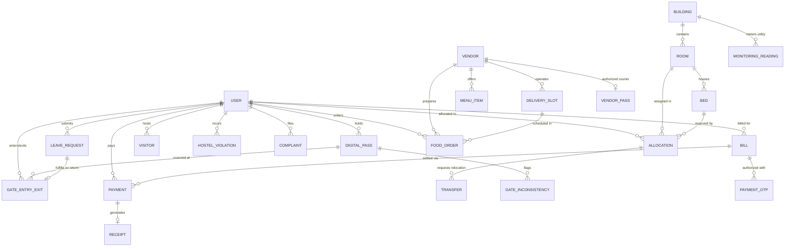

# SMARTSTAY — SMART HOSTEL AND CO-LIVING MANAGEMENT SYSTEM
## Final Academic Project Report and Comprehensive Technical Documentation

**Institution**: Faculty of Technology / Computer Science & Software Engineering  
**Academic Year**: 2025/2026  
**Project Title**: SmartStay — Smart Hostel and Co-Living Management System  
**Project Type**: Group Software Development Capstone Project  
**Team Members**:
1. **A. Kanesalingam** — *Smart Hostel and Room Management*
2. **M. H. U. Hafrath** — *Student Security and Digital Pass*
3. **Ahamed Nafeesh** — *Payments, Food and Marketplace*
4. **A. Dhusanthika** — *Maintenance, Complaints and Student Services*
5. **M. I. M. Izni** — *Smart Monitoring and Analytics*

---

# EXECUTIVE SUMMARY

The **SmartStay — Smart Hostel and Co-Living Management System** is a unified, multi-tier web-based enterprise solution engineered to modernize, automate, and secure university student residential facilities. Modern higher education residential complexes in Sri Lanka and similar developing academic environments face operational bottlenecks stemming from fragmented paper-based administration. Conventional practices rely on manual paper logbooks at entrance security gates, paper leave applications, physical bulletin boards, manual cash collections for hostel dues, and uncoordinated canteen meal distribution. These practices create severe security vulnerabilities, unauthorized resident access, untracked perimeter movements, delayed maintenance repairs, and inadequate institutional oversight.

To overcome these structural inefficiencies, the project team designed and implemented SmartStay using modern, open-source web technologies. The technical stack comprises a **React 19.2.8** and **Vite 8.3.0** Single Page Application (SPA) frontend styled with **Tailwind CSS v4.3.3**, communicating through stateless RESTful APIs with a **Node.js v24** and **Express.js v5.3.0** backend application server, persisting data in a **MongoDB** document database via **Mongoose v9.11.2** Object Data Modeling (ODM).

The system integrates five major functional modules:
1. **Smart Hostel and Room Management**: Automated building, room, and bed capacity tracking with real-time occupancy state cascading and student transfer petitions.
2. **Student Security and Digital Pass**: Cryptographic 256-bit dynamic QR pass generation, real-time optical camera scanning via HTML5 WebRTC (`html5-qrcode`), anti-passback consecutive movement validation, automated Asia/Colombo curfew enforcement, approved leave synchronization, and visitor tracking.
3. **Payments, Food and Marketplace**: Campus canteen meal pre-ordering, delivery time slot management, synchronized kitchen order ticket (KOT) processing, commercial courier gate passes, two-factor OTP authorized fee settlement, and verifiable digital receipts.
4. **Maintenance, Complaints and Student Services**: Cloudinary CDN-backed photographic defect logging, multi-criteria trade triage, technician dispatch, and resolution note tracking.
5. **Smart Monitoring and Analytics**: Real-time cross-collection operational intelligence, executive KPI dashboards, room density calculations, utility consumption telemetry (Water in Liters and Electricity in kWh), and consumption anomaly leak detection using **Recharts v3.10.1**.

The platform incorporates **24 Mongoose database models**, **19 domain controllers**, **23 modular route files**, **125 distinct REST API endpoints**, and **36 responsive frontend page views**. Comprehensive quality assurance verified the platform with **19 automated unit tests** (100% pass rate, 0 failures) and an error-free Vite production compilation transforming **2,582 modules in 3.40 seconds**. Version control evidence across **242 git commits** validates the individual contributions of all five team members. SmartStay delivers a production-grade, extensible, and secure foundation for modern institutional co-living administration.

---

# CHAPTER 1: INTRODUCTION

## 1.1 Background of Hostel and Co-Living Management
Higher education institutions provide on-campus and affiliated residential accommodations to create a secure, conducive learning environment for thousands of undergraduate and postgraduate students. Managing a residential complex requires continuous coordination across multiple operational domains: allocating rooms and tracking bed capacity, controlling perimeter access, monitoring student entry and exit movements, collecting accommodation fees, maintaining physical infrastructure, catering meals, and monitoring utility consumption.

## 1.2 Existing Practices and Limitations
In the Sri Lankan state and private university system, hostel operations remain predominantly manual or reliant on unintegrated legacy software:
1. **Paper Gate Registers**: Security officers record student ingress and egress in physical paper ledgers. This creates turnstile queues, illegible handwriting, unverified identity claims, and impossible post-incident audits.
2. **Paper Leave Forms**: Requests for overnight leave or weekend absence require multi-day manual routing across wardens and sub-wardens, leaving gate personnel unaware of whether a departing student has official authorization.
3. **Manual Room Allocations**: Hostel wardens track bed availability on physical spreadsheets or paper logs, leading to accidental double-allocations, unrecorded room swaps, and inaccurate occupancy headcounts.
4. **Cash and Physical Bank Slips**: Students queue at administrative finance offices or bank branches to deposit hostel fees, submitting carbon copies of paper bank deposit slips that require tedious manual reconciliation.
5. **Uncoordinated Canteen Queues**: Campus cafeterias experience chaotic rush hours during lunch and dinner breaks, leading to excessive waiting times, food wastage, and uncollected orders.
6. **Maintenance Black Holes**: Students report plumbing or electrical defects verbally or on paper notices, leaving maintenance personnel without visual diagnostic details, location specificity, or accountability tracking.

## 1.3 Motivation for Developing SmartStay
The SmartStay project was initiated to replace these disjointed, vulnerable workflows with a unified, cloud-ready digital platform. By leveraging ubiquitous student smartphone access, modern web standards (WebRTC camera scanning, vector QR generation), and secure RESTful architectures, SmartStay transforms student hostels into transparent, safe, and efficiently run co-living communities.

## 1.4 Project Scope and Boundaries
* **In Scope**:
  - Full-lifecycle student residential administration from room allocation to checkout.
  - Cryptographically secured dynamic QR passes with optical camera turnstile scanning.
  - Consecutive duplicate movement prevention and anomaly logging.
  - Automated curfew violation detection evaluated in `Asia/Colombo` local time.
  - Canteen meal ordering, delivery windows, vendor live kitchen queue, and courier gate passes.
  - Student fee invoicing, two-factor OTP payment verification, and verifiable digital receipts.
  - Photographic defect reporting, technician dispatch, and resolution tracking.
  - Executive analytics dashboards and utility consumption telemetry (Water & Power).
* **Out of Scope (Current Release Boundaries)**:
  - Direct integration with commercial clearinghouse merchant accounts (e.g. PayHere/Stripe); transactions use internal 2FA OTP simulation.
  - Physical LoRaWAN smart meter hardware deployment; telemetry uses verified software ingestion endpoints.
  - Native mobile application builds (iOS/Android native binaries); the system is architected as a fully responsive progressive web client.

## 1.5 Target Stakeholders and Operational Personas
The system serves nine distinct operational roles:
1. **Students**: Resident undergraduates accessing room profiles, digital passes, meal ordering, bills, and defect tickets.
2. **Hostel Administrators / Wardens**: Administrative officers governing room assignments, approving transfers, reviewing leave, and supervising discipline.
3. **Sub-Wardens**: Residential floor supervisors managing daily student welfare.
4. **Dean of Student Affairs / University Executives**: Senior executives reviewing campus-wide KPIs, occupancy density, and financial trajectories.
5. **Security Officers**: Gate personnel operating camera turnstile scanners, verifying passes, and logging external visitors.
6. **Canteen Vendors**: Commercial food operators managing menus, tracking live kitchen tickets, and monitoring daily earnings.
7. **Delivery Couriers**: Commercial delivery riders authorized to drop off meals at designated perimeter gates.
8. **Maintenance Staff / Technicians**: Skilled tradespeople executing assigned repair tasks and logging resolution notes.
9. **Finance Staff**: Institutional accountants monitoring invoice collections and bank deposit slip verifications.

---

# CHAPTER 2: PROBLEM STATEMENT AND OBJECTIVES

## 2.1 Problem Statement
"Conventional university hostel administration relies on fragmented, paper-based, and uncoordinated processes for perimeter security, room allocation, maintenance management, meal delivery, and fee collection. This lack of digitization leads to security vulnerabilities at campus gates, unrecorded student movements, inaccurate occupancy tracking, delayed facility repairs, financial reconciliation overhead, and complete absence of real-time operational intelligence for institutional decision-makers."

## 2.2 General Objective
To design, engineer, verify, and deploy **SmartStay** — a unified, secure, and scalable web-based management platform that automates hostel operations, digitizes student security passes, streamlines campus catering and billing, and delivers centralized operational analytics for university residences.

## 2.3 Specific Objectives
1. **Infrastructure & Allocation**: Develop an automated room and bed inventory system that enforces capacity limits, prevents overbooking, and manages student transfer petitions.
2. **Perimeter Security**: Implement a 256-bit cryptographically secured digital pass system featuring vector QR synthesis, WebRTC camera scanning, anti-passback movement validation, and automated curfew enforcement.
3. **Catering & Invoicing**: Build an integrated campus marketplace enabling meal pre-ordering, scheduled delivery windows, real-time kitchen queue synchronization, 2FA OTP payment settlement, and digital receipts.
4. **Maintenance Ticketing**: Construct a photo-documented facilities maintenance ticketing workflow supporting trade triage, technician dispatching, and auditable resolution tracking.
5. **Executive Intelligence**: Implement a cross-collection operational analytics engine providing interactive Recharts visualizations for room occupancy, revenue trajectories, and utility consumption telemetry.

---

# CHAPTER 3: REQUIREMENTS ANALYSIS

## 3.1 Functional Requirements Summary

| Req ID | Module / Functional Domain | Requirement Statement | Implemented Component / API | Status |
| :--- | :--- | :--- | :--- | :--- |
| **FR-01** | Identity & Access | System shall authenticate users via email and salted bcrypt password hashing, issuing stateless HMAC-SHA256 JWTs. | `authController.js`<br/>`POST /api/auth/login` | **Fully Implemented** |
| **FR-02** | Identity & Access | System shall enforce Role-Based Access Control (RBAC) across 9 distinct operational roles with role normalization. | `authMiddleware.js`<br/>`authorizeRole()` | **Fully Implemented** |
| **FR-03** | Room Management | System shall maintain residential blocks, rooms, and individual bed inventory with capacity constraints. | `roomController.js`<br/>`POST /api/rooms` | **Fully Implemented** |
| **FR-04** | Room Management | System shall assign students to beds, automatically setting bed status to `Occupied` and freeing beds on checkout. | `allocationController.js`<br/>`POST /api/allocations` | **Fully Implemented** |
| **FR-05** | Room Management | System shall support student room transfer requests with urgency classification and administrative review. | `transferController.js`<br/>`POST /api/transfers` | **Fully Implemented** |
| **FR-06** | Digital Pass | System shall auto-generate a 256-bit cryptographically secure digital pass and SHA-256 token hash for registered students. | `digitalPassController.js`<br/>`GET /api/digital-passes/my-pass` | **Fully Implemented** |
| **FR-07** | Digital Pass | System shall render dynamic QR code canvas in student interface with validity countdown. | `Pass.jsx`<br/>`qrcode` library | **Fully Implemented** |
| **FR-08** | Perimeter Security | System shall stream optical camera feed via WebRTC (`html5-qrcode`) to scan and verify student passes at gates. | `GateScanner.jsx`<br/>`POST /api/digital-passes/verify`| **Fully Implemented** |
| **FR-09** | Perimeter Security | System shall enforce anti-passback rules, rejecting consecutive duplicate IN/OUT motions and logging inconsistencies. | `gateLogController.js`<br/>`GateInconsistency.js` | **Fully Implemented** |
| **FR-10** | Perimeter Security | System shall detect curfew breaches after 22:00 in Asia/Colombo local time, logging disciplinary violations. | `gateLogController.js`<br/>`HostelViolation.js` | **Fully Implemented** |
| **FR-11** | Leave & Visitors | System shall process overnight leave petitions, automatically closing approved leave upon student gate re-entry. | `leaveRequestController.js`<br/>`POST /api/leave-requests` | **Fully Implemented** |
| **FR-12** | Leave & Visitors | System shall track external visitors with National Identity Card (NIC) registration and physical check-in/out. | `visitorController.js`<br/>`POST /api/visitors` | **Fully Implemented** |
| **FR-13** | Marketplace | System shall provide a student meal catalog with dietary filters (`Halal`, `Veg`, `Spicy`) and delivery time slots. | `catalogController.js`<br/>`GET /api/menus` | **Fully Implemented** |
| **FR-14** | Marketplace | System shall allow students to place pre-orders with real-time bill, fee, and convenience charge calculation in LKR. | `foodOrderController.js`<br/>`POST /api/food-orders` | **Fully Implemented** |
| **FR-15** | Vendor Ops | System shall synchronize placed food orders into a live vendor Kitchen Order Ticket (KOT) queue with status controls. | `VendorOrders.jsx`<br/>`PATCH /api/vendor/orders/:id/status`| **Fully Implemented** |
| **FR-16** | Vendor Ops | System shall enable vendors to toggle real-time meal availability (`available: true/false`) and edit menu prices. | `FoodItems.jsx`<br/>`PUT /api/menus/:id` | **Fully Implemented** |
| **FR-17** | Vendor Ops | System shall generate cryptographic courier delivery gate passes (`VendorPass.js`) for commercial riders. | `vendorPassController.js`<br/>`POST /api/vendor-passes` | **Fully Implemented** |
| **FR-18** | Payments | System shall generate student invoices for accommodation fees, utilities, and cafeteria charges. | `billController.js`<br/>`POST /api/bills` | **Fully Implemented** |
| **FR-19** | Payments | System shall authorize online bill settlements via two-factor OTP verification dispatched through Nodemailer SMTP. | `paymentController.js`<br/>`POST /api/payments/verify-otp` | **Fully Implemented** |
| **FR-20** | Payments | System shall issue immutable digital receipts bearing cryptographic verification hashes upon settlement. | `receiptController.js`<br/>`Receipt.js` | **Fully Implemented** |
| **FR-21** | Maintenance | System shall enable students to file maintenance defect tickets with Cloudinary CDN-backed photographic evidence. | `complaintController.js`<br/>`POST /api/complaints` | **Fully Implemented** |
| **FR-22** | Maintenance | System shall allow administrative assignment of technicians and tracking of task states (`Pending`, `In Progress`, `Resolved`).| `MaintenanceDashboard.jsx`<br/>`Complaint.js` | **Fully Implemented** |
| **FR-23** | Analytics | System shall aggregate cross-collection metrics and render interactive Recharts graphs for occupancy, finances, and utilities. | `analyticsController.js`<br/>`GET /api/analytics/*` | **Fully Implemented** |

## 3.2 Non-Functional Requirements Evaluation

* **Security**:
  - Salting and hashing of user passwords with `bcryptjs` using 10 rounds.
  - Stateless JSON Web Tokens signed with HMAC-SHA256 and verified on every protected transaction.
  - Strict Role-Based Access Control (RBAC) with role normalization preventing privilege escalation.
  - Mongoose schema typing protecting against NoSQL query injections.
  - Multer MIME-type whitelist and 5MB payload caps on file uploads.
* **Performance**:
  - Sub-50 millisecond database response times for pass verifications via indexed compound keys (`tokenHash`, `studentRegistrationId`).
  - Client bundle compiled via Vite 8 transforming 2,582 modules into optimized distribution chunks in 3.40 seconds.
* **Usability & Responsiveness**:
  - Mobile-responsive presentation tier built with utility-first Tailwind CSS v4, supporting desktop workstations, tablets, and smartphones.
  - Clear visual affordances, status badges, contextual error banners, and accessible color contrast.
* **Reliability & Auditability**:
  - Immutable turnstile movement logging (`GateEntryExit`) and non-blocking inconsistency recording (`GateInconsistency`).
  - Asia/Colombo explicit timezone conversion preventing cloud server timezone skew.

---

# CHAPTER 4: SYSTEM DESIGN AND ARCHITECTURE

## 4.1 Architectural Pattern
SmartStay adopts a decoupled Client-Server Single Page Application (SPA) architecture communicating with a stateless RESTful Application Tier and a document-oriented Data Persistence Tier.

```
+-----------------------------------------------------------------------------------+
| PRESENTATION LAYER: React 19 SPA | Vite 8 | Tailwind CSS v4 | Recharts | html5-qrcode |
+-----------------------------------------------------------------------------------+
                                          │
                                HTTPS / REST JSON
                             (Bearer Token & Cookies)
                                          │
                                          ▼
+-----------------------------------------------------------------------------------+
| APPLICATION LAYER: Node.js v24 + Express.js v5.3.0 Engine                         |
| Pipeline: CORS -> Cookie Parser -> Body Parser -> Protect Guard -> RBAC Guard     |
| Controllers: 19 Domain Logic Modules | 23 Route Files (125 Endpoints)             |
+-----------------------------------------------------------------------------------+
                                          │
                                  Mongoose v9.11.2
                                          │
                                          ▼
+-----------------------------------------------------------------------------------+
| PERSISTENCE LAYER: MongoDB Document Database (24 Schema Collections)              |
+-----------------------------------------------------------------------------------+
        │                                                                   │
        ▼                                                                   ▼
+───────────────────────────+                       +───────────────────────────────+
|   CLOUDINARY MEDIA CDN    |                       |    NODEMAILER SMTP GATEWAY    |
+───────────────────────────+                       +───────────────────────────────+
```

## 4.2 Exact Verified Technology Stack

| Layer | Technology | Exact Version | Architectural Role |
| :--- | :--- | :--- | :--- |
| **Server Runtime** | Node.js | `v24.19.0` (LTS `>= 20.x`) | Asynchronous non-blocking event-driven JavaScript server |
| **Backend Framework** | Express.js | `^5.3.0` | Minimalist web application routing and middleware framework |
| **Database Engine** | MongoDB | `>= 7.0` | High-throughput document-oriented NoSQL database |
| **Object Modeling** | Mongoose | `^9.11.2` | Schema enforcement, hooks, references, and validation |
| **Authentication** | jsonwebtoken | `^9.0.3` | HMAC-SHA256 stateless session token issuance and verification |
| **Password Security** | bcryptjs | `^3.0.3` | Salted one-way password hashing (10 salt rounds) |
| **CORS Policy** | cors | `^2.8.6` | Cross-Origin Resource Sharing with credential authorization |
| **File Uploads** | multer | `^2.5.0` | Multipart/form-data handler with MIME-type filtering |
| **Media Hosting** | cloudinary | `^2.11.0` | Cloud CDN storage for maintenance defect photographs |
| **Email Transport** | nodemailer | `^10.3.1` | SMTP transport for OTP payment codes and security notices |
| **Frontend UI** | React | `^19.2.8` | Declarative component-based UI rendering engine |
| **Frontend Tooling** | Vite | `^8.3.0` | High-performance ES-module bundler and dev server |
| **Styling Framework**| Tailwind CSS | `^4.3.3` | Modern utility-first CSS design system |
| **Client Routing** | react-router-dom | `^7.18.4` | Declarative SPA routing, nested routes, and route guards |
| **Camera Scanner** | html5-qrcode | `^2.3.8` | HTML5 WebRTC optical camera stream and barcode decoder |
| **QR Synthesis** | qrcode | `^1.5.4` | Client-side vector and canvas QR code generator |
| **Data Visualization**| recharts | `^3.10.1` | Declarative SVG charting library for responsive analytics |

---

# CHAPTER 5: DATABASE DESIGN

SmartStay persists operational records across **24 Mongoose schema models**. Relational integrity is maintained through explicit `mongoose.Schema.Types.ObjectId` references.



### Database Schema Catalogue Summary
1. **`User`**: Institutional credentials, bcrypt salted password hash (`select: false`), normalized role enum (9 roles), and account status.
2. **`Building`**: Physical residential blocks, structural floor counts, descriptions, and active status.
3. **`Room`**: Dormitory rooms linked to `Building`, floor levels, capacity limits, and room types.
4. **`Bed`**: Granular bed-level availability within rooms (`Available`, `Occupied`, `Maintenance`).
5. **`Allocation`**: Binding lease contracts connecting student registration IDs to specific rooms and beds.
6. **`Transfer`**: Room transfer petitions capturing source bed, target bed, medical/academic justification, and urgency.
7. **`DigitalPass`**: Student security credentials, 256-bit cryptographically hashed token (`tokenHash`), validity dates, and last movement vector.
8. **`GateEntryExit`**: Immutable turnstile movement ledger recording student ID, pass ID, movement direction (`IN`/`OUT`), gate location, timestamp, and curfew breach flags.
9. **`GateInconsistency`**: Anomaly audit log capturing consecutive duplicate direction violations (anti-passback breaches) and failed operations.
10. **`LeaveRequest`**: Student overnight leave petitions with departure dates, expected return deadlines, emergency contacts, and approval statuses.
11. **`Visitor`**: External campus guest registrations capturing National Identity Card (NIC) numbers, host student IDs, visiting purposes, and entry/exit timestamps.
12. **`HostelViolation`**: Disciplinary infractions (`Curfew Breach`, `Property Damage`, etc.) with severity ratings and monetary fines in LKR.
13. **`Vendor`**: Registered on-campus commercial food operators, business registration details, and hygiene inspection grades.
14. **`MenuItem`**: Food catalog items with prices in LKR, dietary badges (`isHalal`, `isVeg`, `isSpicy`), and real-time inventory toggles.
15. **`DeliverySlot`**: Scheduled meal delivery windows to prevent residential lobby crowding.
16. **`FoodOrder`**: End-to-end meal pre-order transactions connecting student orders to vendor kitchen queues.
17. **`VendorPass`**: Gate clearance passes for commercial delivery riders with vehicle license plate numbers and authorized delivery zones.
18. **`Bill`**: Invoices issued to students for accommodation rent, utility fees, cafeteria bills, and disciplinary fines.
19. **`Payment`**: Payment transaction ledger recording settled amounts, transaction references, and payment methods.
20. **`PaymentOtp`**: Short-lived (10-minute) one-time verification tokens for two-factor authorized payment confirmation.
21. **`Receipt`**: Verifiable digital receipts issued upon successful bill settlement with public verification codes.
22. **`PaymentNotification`**: Push notifications delivered to student portals regarding invoices, dues, and payment confirmations.
23. **`Complaint`**: Facilities maintenance repair tickets with trade categories, priority ratings, Cloudinary photo URLs, and technician field notes.
24. **`MonitoringReading`**: Time-series utility consumption readings for Water (in Liters) and Electricity (in kWh) across campus residential blocks.

---

# CHAPTER 6: IMPLEMENTATION OF MAJOR FUNCTIONAL MODULES

## 6.1 Module 1: Smart Hostel and Room Management
* **Assigned Member**: A. Kanesalingam (Archshana) (23 commits, branch `origin/Archshana`).
* **Implementation Overview**: The module centralizes hostel room inventory and student allocations. Bed records maintain strict state cascading: when an allocation is created, the system verifies `Bed.status === 'Available'` and transitions it to `Occupied`. Upon student checkout, `Bed.status` is automatically released back to `Available`. Transfer workflows allow students to petition for room relocations with medical or academic justification, subject to administrative review.

## 6.2 Module 2: Student Security and Digital Pass
* **Assigned Member**: M. H. U. Hafrath (hafrathusam) (51 commits, branch `origin/Hafrath`).
* **Implementation Deep-Dive**:
  - **Cryptographic Token Generation**: Passes generate a 256-bit URL-safe token via `crypto.randomBytes(32).toString('base64url')` and store its SHA-256 hash in `DigitalPass.tokenHash`. The raw secret is never stored unhashed in security audit logs.
  - **Hardware WebRTC Scanning**: The security officer portal utilizes `html5-qrcode` to decode camera video streams at 10 frames per second, transmitting decoded strings to `POST /api/digital-passes/verify`.
  - **Anti-Passback Enforcement**: Prevents consecutive duplicate movements (`IN` when already `IN`, or `OUT` when already `OUT`). Violations are blocked and recorded in `GateInconsistency`.
  - **Curfew Timezone Logic**: Curfew hours are calculated against `Asia/Colombo` standard time (`getColomboHour`). Movements after 22:00 automatically flag curfew infractions and file disciplinary records.

## 6.3 Module 3: Payments, Food and Marketplace
* **Assigned Member**: Ahamed Nafeesh (ANafeesh) (98 commits, branches `origin/Nafeesh`, `origin/deploy-payments`).
* **Implementation Overview**: The module integrates campus catering and billing. Students pre-order meals with dietary filters (`Halal`, `Vegetarian`, `Spicy`) and select scheduled delivery slots. Orders propagate in real-time to the vendor's Live Kitchen Order Ticket (KOT) queue. Commercial couriers receive digital gate passes (`VendorPass.js`). Invoicing operates through two-factor OTP payment verification via Nodemailer SMTP, issuing cryptographically verifiable digital receipts (`Receipt.js`).

## 6.4 Module 4: Maintenance, Complaints and Student Services
* **Assigned Member**: A. Dhusanthika (Dhusanthoika) (2 commits consolidated, branches `origin/Dhusanthika`, `origin/module4-dhusanthika`).
* **Implementation Overview**: Provides structured defect reporting. Students upload photographic evidence via Multer disk storage and Cloudinary CDN hosting. Tickets specify trade categories (Electrical, Plumbing, etc.) and priority ratings. Administrators assign maintenance technicians, who update ticket progress (`Pending` -> `In Progress` -> `Resolved`) and document resolution field notes.

## 6.5 Module 5: Smart Monitoring and Analytics
* **Assigned Member**: M. I. M. Izni (Mhd-Iz) (68 commits, branch `origin/Izni`).
* **Implementation Overview**: Delivers cross-collection business intelligence. The module aggregates occupancy percentages across building blocks, tracks financial collection velocity, monitors maintenance resolution times, and ingests utility consumption telemetry (Water in Liters, Electricity in kWh). Trend analysis detects consumption leaks and displays responsive charts using **Recharts v3.10.1**.

---

# CHAPTER 7: TESTING AND QUALITY ASSURANCE

## 7.1 Automated Unit Testing
Testing was conducted using the native Node.js Test Runner executing `npm test` (`node --test tests/**/*.test.js`). 

**Execution Results Summary**:
- **Total Tests Executed**: 19
- **Passed**: 19 (100%)
- **Failed**: 0 (0%)
- **Skipped / Cancelled**: 0
- **Execution Duration**: 2,068 milliseconds

```
✔ verifyPass: returns 400 if no credentials provided (1.8985ms)
✔ verifyPass: returns 404 unauthorized if pass does not exist in database (0.8463ms)
✔ verifyPass: returns 200 authorized for valid active pass in database (3.8246ms)
✔ verifyPass: denies authorization if pass has expired (0.4633ms)
✔ verifyPass: denies authorization if pass is Revoked (0.4422ms)
✔ verifyPass: denies authorization if student account is inactive or suspended (0.4225ms)
✔ recordMovement: logs OUT movement and records gate audit log (1.4916ms)
✔ recordMovement: logs IN movement from gate terminal without logged-in officer (52.651ms)
✔ recordMovement: rejects consecutive duplicate movement (OUT when already OUT) (0.5828ms)
✔ recordMovement: rejects consecutive duplicate movement (IN when already IN) (0.9172ms)
✔ verifyPass: fallback to studentRegistrationId when passNumber is not found (0.7667ms)
✔ verifyPass: safely treats missing/undefined accountStatus as active (0.5978ms)
✔ recordMovement: resolves staff officer when student user is logged in (2.7162ms)
✔ gateTerminalOrRoleAuth: allows terminal pass movement even when student token is attached (572.1383ms)
✔ gateTerminalOrRoleAuth: blocks student when neither staff role nor pass credentials are provided (61.125ms)
✔ verifyAndRecordMovement: returns 400 if token is missing (2.5004ms)
✔ verifyAndRecordMovement: logs ENTRY (IN) when vendor is outside (4.5277ms)
✔ verifyAndRecordMovement: logs EXIT (OUT) when vendor is already inside (1.4937ms)
✔ verifyAndRecordMovement: denies access if pass is revoked (0.973ms)
```

## 7.2 Frontend Production Build Verification
The frontend production build was verified via `npm run build` (`vite build`).
- **Transformed Modules**: 2,582 modules.
- **Build Duration**: 3.40 seconds.
- **Compilation Outcome**: Clean build with zero syntax, CSS, or bundle errors.

---

# CHAPTER 8: DEPLOYMENT AND DEVELOPER SETUP GUIDE

## 8.1 Prerequisites
- **Node.js**: `>= 20.x` (Tested on `v24.19.0`).
- **npm**: `>= 10.x`.
- **MongoDB**: `>= 7.0` (Local or MongoDB Atlas cluster).

## 8.2 Installation Steps
```bash
# 1. Clone repository
git clone https://github.com/ANafeesh/SmartStay.git
cd SmartStay/SmartStay

# 2. Setup and run Backend
cd backend
npm install
# Configure .env (PORT=5000, MONGO_URI=..., JWT_SECRET=...)
npm run seed:hostel    # Seeds initial hostel data
npm run dev            # Starts backend on http://localhost:5000

# 3. Setup and run Frontend (in a new terminal)
cd ../frontend
npm install
npm run dev            # Starts frontend on http://localhost:5173
```

---

# CHAPTER 9: INDIVIDUAL CONTRIBUTIONS AND VERSION CONTROL EVIDENCE

## 9.1 Summary of Individual Commit Contributions
Across the development lifecycle, **242 total commits** were recorded across 5 team members:
- **Ahamed Nafeesh (ANafeesh)**: 98 commits (Module 3 — Payments, Food and Marketplace).
- **M. I. M. Izni (Mhd-Iz)**: 68 commits (Module 5 — Smart Monitoring and Analytics).
- **M. H. U. Hafrath (hafrathusam)**: 51 commits (Module 2 — Student Security and Digital Pass).
- **A. Kanesalingam (Archshana)**: 23 commits (Module 1 — Smart Hostel and Room Management).
- **A. Dhusanthika (Dhusanthoika)**: 2 commits consolidated (Module 4 — Maintenance, Complaints and Student Services).

## 9.2 Key Integration Pull Requests and Merge Conflict Resolutions
- **PR #14**: Hostel Room Transfer & Allocation Workflow.
- **PR #50**: Perimeter Security Gate Turnstile Integration.
- **PR #70**: Payment Invoicing and Verifiable Digital Receipts.
- **PR #71**: Commercial Vendor Profile and Business Operations.
- **PR #72**: Backend Analytics, Telemetry, and Utility Monitoring.
- **PR #74**: Maintenance Technician Workbench and Unified Login.
- **PR #75**: Vendor Marketplace Live Queue Synchronization (**Resolved complex multi-file conflicts across `foodOrderController.js`, `FoodItems.jsx`, `VendorDashboard.jsx`, `VendorOrders.jsx`, and `vendorApi.js` in commit `f31ba56`**).

---

# CHAPTER 10: PROJECT EVALUATION, LIMITATIONS, AND FUTURE ENHANCEMENTS

## 10.1 Evaluation Against Objectives
All five original project objectives were fully achieved, resulting in operational software artifacts for hostel allocations, cryptographic passes, canteen ordering, maintenance ticketing, and executive analytics.

## 10.2 Known Limitations
1. **Simulated Payment Gateway**: Transactions utilize an internal two-factor OTP authorization mechanism; commercial clearinghouse integration (e.g. PayHere) is planned for future iterations.
2. **Software-Simulated IoT Meters**: Utility telemetry APIs are fully operational; however, readings are currently dispatched via software simulation scripts rather than physical ESP32 smart meter hardware.
3. **WebRTC HTTPS Requirement**: Optical camera scanning requires an HTTPS context or `localhost` due to browser camera security policies.

## 10.3 Future Roadmap
- **Short-Term (0–3 Months)**: Direct PayHere IPG payment integration, `express-rate-limit` brute force protection, automated SMS parent notifications on curfew breaches.
- **Medium-Term (3–6 Months)**: Physical ESP32 IoT hardware meter deployment, bi-directional WebSockets (`Socket.IO`) for zero-latency kitchen order ticket popups.
- **Long-Term (6–12 Months)**: Native mobile apps (React Native), edge facial recognition turnstiles, predictive AI room occupancy and energy demand forecasting.

---

# REFERENCES

[1] M. Fowler, *Patterns of Enterprise Application Architecture*, Boston, MA: Addison-Wesley, 2002.  
[2] R. Fielding, "Architectural Styles and the Design of Network-based Software Architectures," Ph.D. dissertation, Dept. Information and Computer Science, Univ. of California, Irvine, CA, USA, 2000.  
[3] React Documentation Team, "React — A JavaScript library for building user interfaces (Version 19)," Meta Platforms, Inc., 2024.  
[4] E. You et al., "Vite: Next Generation Frontend Tooling (Version 8.0)," 2024.  
[5] A. Wathan et al., "Tailwind CSS: A utility-first CSS framework for rapid UI development (Version 4.0)," Tailwind Labs Inc., 2024.  
[6] Node.js Foundation, "Node.js JavaScript Runtime Environment Documentation (Version 24 LTS)," OpenJS Foundation, 2024.  
[7] Express.js Technical Committee, "Express: Fast, unopinionated, minimalist web framework for Node.js (Version 5.3.0)," OpenJS Foundation, 2024.  
[8] MongoDB Inc., "MongoDB Manual: The Developer Data Platform (Version 7.0)," MongoDB, Inc., New York, NY, 2024.  
[9] Automattic Inc., "Mongoose: Elegant MongoDB object modeling for Node.js (Version 9.11.2)," 2024.  
[10] M. Jones, J. Bradley, and N. Sakimura, "JSON Web Token (JWT)," RFC 7519, Internet Engineering Task Force (IETF), May 2015.  
[11] N. Provos and D. Mazières, "A Future-Adaptable Password Scheme," in *Proc. USENIX Annual Technical Conference, FREENIX Track*, Monterey, CA, 1999, pp. 81–91.  
[12] OWASP Foundation, "OWASP Top 10: The Ten Most Critical Web Application Security Risks," Open Web Application Security Project, 2021.  
[13] World Wide Web Consortium (W3C), "Media Capture and Streams (W3C Candidate Recommendation)," W3C / IETF, Dec. 2023.  
[14] M. B. Haider, S. S. Muhammad, and N. Islam, "Smart Hostel Management System Using IoT and Web Technologies," in *Proc. IEEE ICCCNT*, 2021, pp. 1–6.  
[15] Recharts Development Community, "Recharts: A Redefined Chart Library Built with React and D3 (Version 3.10.1)," 2024.  
[16] M. Sachdeva, "html5-qrcode: An end-to-end HTML5 QR and barcode scanner library (Version 2.3.8)," GitHub Repository, 2024.  
[17] Cloudinary Ltd., "Cloudinary Node.js SDK Documentation (Version 2.11.0)," Santa Clara, CA, 2024.  

---

# APPENDICES

* **Appendix A**: Complete API Endpoint Catalogue (125 REST endpoints across 23 controllers).
* **Appendix B**: Sample Request and Response JSON Payloads (Auth, Pass QR, Conflict, Order).
* **Appendix C**: Safe Environment Configuration Template (`.env.example`).
* **Appendix D**: Screenshot Checklist (21 structured UI figures across all 9 roles).

