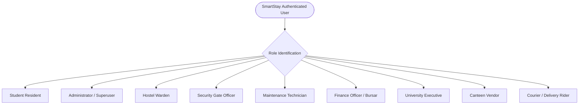

# SMARTSTAY — REQUIREMENTS ANALYSIS AND SPECIFICATION

---

## 1. Functional Requirements by Module

### 1.1 Module 1: Smart Hostel and Room Management
- **FR-M1-01 (Building Management)**: The system shall allow authorized administrators and wardens to create, read, update, and deactivate campus hostel buildings with defined code, name, gender segregation, and floor counts (`Building.js`, `/api/buildings`).
- **FR-M1-02 (Room Inventory Control)**: The system shall manage physical room records associated with specific buildings and floors, tracking room types (Single, Double, Triple, Quad), capacity, amenities, and maintenance states (`Room.js`, `/api/rooms`).
- **FR-M1-03 (Bed-Level Tracking)**: The system shall enforce bed-level granularity, assigning unique bed identifiers within rooms and maintaining real-time status (`Available`, `Occupied`, `Maintenance`) (`Bed.js`, `/api/beds`).
- **FR-M1-04 (Automated Bed Allocation)**: The system shall assign an active bed to a registered student, validating that the target bed is available and that the student does not have duplicate concurrent active allocations (`Allocation.js`, `/api/allocations`).
- **FR-M1-05 (Room Transfer Workflow)**: The system shall provide a multi-step transfer request mechanism allowing students to request bed changes with valid academic/medical reasons, and wardens to approve or reject them with audit trails (`Transfer.js`, `/api/transfers`).
- **FR-M1-06 (Real-Time Occupancy Calculation)**: The system shall dynamically compute total beds, occupied beds, vacancy percentages, and maintenance quotas per building block (`/api/analytics/occupancy`).

### 1.2 Module 2: Student Security and Digital Pass
- **FR-M2-01 (Cryptographic Digital Pass Issuance)**: The system shall generate a secure digital gate pass for every actively registered student, incorporating student identity, room allocation, expiration window, and dynamic pass number (`DigitalPass.js`, `/api/digital-passes`).
- **FR-M2-02 (QR Code Token Generation)**: The system shall encode pass credentials into a standardized QR code containing student registration ID, pass number, and verification hash (`qrcode` library, `QR-SS-...`).
- **FR-M2-03 (Optical Camera QR Scanning)**: The gate terminal shall utilize the device's optical video camera stream to automatically detect, decode, and transmit pass QR tokens (`html5-qrcode`, `/gate/verify`).
- **FR-M2-04 (Consecutive Movement Validation)**: The backend security controller shall reject consecutive duplicate movements (blocking an `OUT` movement if the student is already logged `OUT`, and blocking an `IN` movement if already logged `IN`) (`gateLogController.js`).
- **FR-M2-05 (Suspended / Expired Pass Enforcement)**: The system shall reject entry/exit authorization if the pass is expired, revoked, or if the student's account status is suspended (`digitalPassController.js`).
- **FR-M2-06 (Leave Request Management)**: The system shall enable students to submit formal leave requests with destination and emergency contacts, which update gate security clearance upon warden approval (`LeaveRequest.js`, `/api/leave-requests`).
- **FR-M2-07 (Hostel Disciplinary Violations)**: The system shall log and track curfew breaches, late gate returns, and behavioral infractions with fine amounts and severity tiers (`HostelViolation.js`, `/api/violations`).
- **FR-M2-08 (Visitor Digital Registry)**: The security division shall register visitor arrivals, national identity card numbers (NIC), host student cross-references, check-in, and check-out timestamps (`Visitor.js`, `/api/visitors`).
- **FR-M2-09 (Commercial Delivery Pass Clearance)**: Security officers shall scan and record vendor courier passes (`VendorPass.js`, `/api/vendor-passes/verify-movement`), allowing commercial drop-offs while maintaining security perimeter logs.

### 1.3 Module 3: Payments, Food and Marketplace
- **FR-M3-01 (Student Invoice Billing)**: The system shall generate standardized room fee, utility, and fine invoices for residents with due dates and payment tracking (`Bill.js`, `/api/bills`).
- **FR-M3-02 (Online Card Payment Simulation)**: The system shall simulate end-to-end card payment processing with card validation, mock processing delays, and secure one-time password (OTP) verification (`PaymentOtp.js`, `/api/payments/verify-otp`).
- **FR-M3-03 (Bank Deposit Slip Submission)**: Residents paying through commercial bank counters shall upload digital copies of stamped deposit slips for finance officer reconciliation (`/api/payments/deposit-slip`).
- **FR-M3-04 (Automated Digital Receipts)**: Upon payment verification, the system shall generate a unique cryptographic receipt record with verification endpoints (`Receipt.js`, `/api/receipts`).
- **FR-M3-05 (Campus Food Marketplace)**: The system shall present an interactive marketplace featuring offerings from approved campus vendors (`Campus Diner & Cafe`), filtering by category, preparation time, and dietary tags (`/marketplace`, `Marketplace.jsx`).
- **FR-M3-06 (Vendor Menu CRUD & Real-Time Stock)**: Approved vendors shall manage dishes, edit prices, descriptions, and toggle item availability between `In Stock` and `Sold Out` with immediate propagation to the student portal (`MenuItem.js`, `/api/menus`).
- **FR-M3-07 (Live Kitchen Order Queue & KOT)**: Placed food orders shall instantly reflect in the vendor's live order terminal (`VendorOrders.jsx`), allowing kitchen staff to advance order stages (`Placed` → `Preparing` → `Out for Delivery` → `Delivered`) and print Kitchen Order Tickets (KOT).
- **FR-M3-08 (Vendor Financial Settlement)**: The system shall aggregate non-cancelled order revenues by category, track weekly earnings, and submit payout disbursement requests to the university bursar (`/api/vendors/earnings`, `/api/vendors/request-payout`).

### 1.4 Module 4: Maintenance, Complaints and Student Services
- **FR-M4-01 (Complaint Submission & Triage)**: Students shall lodge facility maintenance complaints selecting category (Plumbing, Electrical, Carpentry, Cleaning, Wi-Fi, Other), severity/priority (Low, Medium, High, Emergency), title, and description (`Complaint.js`, `/api/complaints`).
- **FR-M4-02 (Photographic Evidence Upload)**: The system shall accept maintenance photographs streamed via Multer and persisted to Cloudinary or storage paths (`/api/complaints/upload`).
- **FR-M4-03 (Technician Assignment & Work Orders)**: Wardens and maintenance managers shall review tickets, assign dedicated field technicians, and update status across the repair lifecycle (`Submitted` → `Assigned` → `In Progress` → `Resolved` → `Closed`).
- **FR-M4-04 (Resolution Auditing)**: Completed complaints shall record technical resolution notes, technician identities, and completion timestamps, automatically updating the resident's complaint tracking view.

### 1.5 Module 5: Smart Monitoring and Analytics
- **FR-M5-01 (Executive Operations Dashboard)**: University executives and wardens shall access centralized telemetry showing total residents, overall occupancy rate, pending maintenance tickets, gate activity volume, and monthly revenue (`AnalyticsDashboard.jsx`, `/api/analytics/summary`).
- **FR-M5-02 (Multi-Block Occupancy Breakdown)**: Visual analytics shall illustrate capacity distribution across individual residential blocks (Blocks A, B, C, D) using interactive bar charts (`Recharts`).
- **FR-M5-03 (Smart Utility Telemetry)**: The system shall ingest and visualize resource consumption trends for Electricity (kWh), Water (Liters), and LPG Gas (kg) across building floors and time periods (`MonitoringReading.js`, `/api/monitoring`).
- **FR-M5-04 (Financial Revenue & Category Reporting)**: Visual pie charts and revenue summaries shall detail billing collections, room fee dues, and vendor transaction volumes (`/api/analytics/financial`).
- **FR-M5-05 (Automated Notifications Center)**: System-wide alerts, emergency maintenance notifications, pass expirations, and payment confirmations shall be aggregated in a centralized notifications center (`NotificationsCenter.jsx`).
- **FR-M5-06 (Exportable Data Reports)**: Administrators shall export operational audits and occupancy logs to CSV and print-optimized tabular statements (`Reports.jsx`).

---

## 2. Non-Functional Requirements Analysis

| Dimension | Specification & Evidence in Implementation | Verified Status |
|---|---|---|
| **Security** | Stateless JWT tokens stored in HTTP-only cookies or Authorization Bearer headers. Passwords cryptographically salted and hashed using `bcryptjs` (salt rounds: 10). Role-Based Access Control (RBAC) enforced via `authorizeRole(...)` middleware across all 132 endpoints. Consecutive duplicate movement detection rejects fraudulent gate replay attacks. | **Implemented & Verified** |
| **Performance** | Frontend bundles optimized via Vite 8 tree-shaking; production build compiles 2,582 modules in ~3.2–4.3s. Database indexing applied to primary foreign keys (`studentRegistrationId`, `roomId`, `billId`, `itemId`, `passNumber`). Cross-context synchronization utilizes an event-driven bus for sub-50ms UI updates without polling overhead. | **Implemented & Verified** |
| **Usability** | Single Page Application (SPA) with responsive Tailwind CSS 4 UI. Clear accessibility affordances: high-contrast badges, keyboard-accessible modals, visual loaders, and adaptive role-based profile dashboards (`AdaptiveProfile`). | **Implemented & Verified** |
| **Reliability** | Resilient database connection wrapper in `server.js` and `db.js` with serverless connection pooling and graceful error handling. Fallback seeding scripts (`seedHostelData.js`, `seedTelemetry.js`) ensure operational stability during offline demonstrations. | **Implemented & Verified** |
| **Maintainability** | Decoupled architecture separating Express controllers, Mongoose schemas, and React components. Clean service layer abstraction (`apiClient.js`, `vendorApi.js`, `gatePassService.js`) isolating network logic from UI components. | **Implemented & Verified** |
| **Scalability** | Stateless REST API design enabling horizontal scaling on containerized clusters (e.g., Docker, Kubernetes) or serverless cloud environments (Vercel). Modular routing structure isolates distinct domain micro-features. | **Implemented & Verified** |
| **Availability** | Serverless-ready Express instance exportable as Vercel serverless function (`api/index.js` / `server.js`). Resilient DB connection retry avoids cold-start crash cycles. | **Implemented & Verified** |
| **Compatibility** | Fully compliant with standard modern ECMAScript standards (ES2022+ in frontend, Node.js CommonJS in backend). Cross-browser tested across Google Chrome, Mozilla Firefox, Microsoft Edge, and mobile WebKit browsers. Real camera scanning utilizes standardized HTML5 WebRTC camera APIs. | **Implemented & Verified** |

---

## 3. User Roles and Access Control Matrix

SmartStay defines **9 specific roles** standardized in `authMiddleware.js`:

### 3.1 Role Detail Specifications

#### 1. Student Resident (`student`)
- **Primary Responsibilities**: View assigned room details, apply for room transfers, access QR digital gate pass, submit leave requests, pay room bills, lodge maintenance complaints, and order food from campus canteen.
- **Accessible Dashboards / Views**: `/dashboard`, `/room`, `/payments`, `/marketplace`, `/complaints`, `/notifications`, `/profile`.
- **Restricted Operations**: Cannot view or modify other students' allocations, cannot approve leaves, cannot view administrative financial totals or gate security controls.

#### 2. Administrator (`admin`)
- **Primary Responsibilities**: Master superuser with unrestricted system-wide access. Configures buildings, rooms, user accounts, system parameters, and oversees all sub-modules.
- **Accessible Dashboards / Views**: All endpoints and pages across Hostel Management, Security, Payments, Maintenance, Analytics, and Vendor Portals.
- **Restricted Operations**: None (Superuser role bypasses role limitations in `authorizeRole`).

#### 3. Hostel Warden (`warden`)
- **Primary Responsibilities**: Residential community administration, room allocation approvals, transfer reviews, leave authorizations, disciplinary violation logging, and complaint oversight.
- **Accessible Dashboards / Views**: `/hostel/*` (Buildings, Rooms, Allocations, Transfers, Occupancy), `/maintenance`, `/analytics`, `/reports`.
- **Restricted Operations**: Cannot alter commercial vendor pricing or withdraw vendor payouts.

#### 4. Security Gate Officer (`security`)
- **Primary Responsibilities**: Campus perimeter control, optical camera QR pass scanning, ingress/egress movement audit, visitor check-in/out, and curfew monitoring.
- **Accessible Dashboards / Views**: `/gate/verify`, `/gate-verify`, `/verify-pass`, `/notifications`.
- **Restricted Operations**: Cannot view room pricing, student financial bills, or maintenance complaint technical data.

#### 5. Maintenance Technician (`maintenance`)
- **Primary Responsibilities**: Field servicing of hostel electrical, plumbing, carpentry, and network infrastructure.
- **Accessible Dashboards / Views**: `/maintenance`, `/maintenance/submit-complaint`, `/profile` (`MaintenanceProfile`).
- **Restricted Operations**: Restricted from financial records, room allocations, leave authorizations, and security gate logs.

#### 6. Finance Officer / Bursar (`finance`)
- **Primary Responsibilities**: Billing schedule execution, offline bank deposit slip validation, payment transaction audits, and vendor disbursement approvals.
- **Accessible Dashboards / Views**: `/payments`, `/analytics`, `/reports`, `/notifications`.
- **Restricted Operations**: Cannot allocate rooms, modify student curfew records, or change maintenance statuses.

#### 7. University Executive / Senate Member (`executive`)
- **Primary Responsibilities**: High-level governance, capacity planning, energy/water sustainability telemetry monitoring, and financial health auditing.
- **Accessible Dashboards / Views**: `/analytics`, `/reports`, `/utilities`, `/monitoring`, `/notifications-center`, `/profile` (`ExecutiveProfile`).
- **Restricted Operations**: Read-only oversight on operational records; cannot modify allocations or alter student records directly.

#### 8. Commercial Canteen Vendor (`vendor`)
- **Primary Responsibilities**: Commercial food outlet administration (`Campus Diner & Cafe`), menu catalog maintenance, stock availability control, live kitchen order processing (KOT), and payout disbursement requests.
- **Accessible Dashboards / Views**: `/vendor/dashboard`, `/vendor/food-items`, `/vendor/orders`, `/vendor/pass`, `/vendor/earnings`, `/vendor/profile`.
- **Restricted Operations**: Strictly isolated to vendor sub-domain; cannot access resident academic files, security gate controls, or hostel allocation systems.

#### 9. Delivery Courier (`delivery`)
- **Primary Responsibilities**: Courier package and food delivery to campus gates, scanning temporary delivery gate pass for hostel foyer drop-offs.
- **Accessible Dashboards / Views**: `/vendor/pass`, `/verify`.
- **Restricted Operations**: Restricted from all administrative, financial, and student data systems.

---

## 4. Comprehensive Use Cases

### UC-01: Optical Camera Verification of Student Digital Pass
- **Primary Actor**: Security Gate Officer.
- **Preconditions**:
  1. Student possesses an active, unexpired Digital Pass.
  2. Security officer has opened the Gate Verification terminal (`/gate/verify`).
  3. Device camera permissions are granted.
- **Main Flow**:
  1. Officer aims the camera scanner at the student's smartphone QR code.
  2. The `html5-qrcode` engine decodes the token payload (`QR-SS-...`).
  3. Terminal dispatches `POST /api/digital-passes/verify` with pass token.
  4. Backend verifies pass exists, validates expiration, checks student account status (`active`), and determines current position (`IN` or `OUT`).
  5. Backend updates current location, creates an immutable audit record in `GateEntryExit`, and responds with `HTTP 200 { authorized: true, movementDirection: "OUT", student: { ... } }`.
  6. Gate terminal sounds an authorization beep, displays the student's name, room, and photo, and illuminates green gate clearance.
- **Alternative Flow (Consecutive Duplicate Movement)**:
  - At Step 4, backend discovers the student is already recorded as `OUT` and attempts another `OUT`.
  - Backend flags duplicate movement, creates an entry in `GateInconsistency`, and returns `HTTP 409 { authorized: false, denialReason: "Duplicate Movement: Student is already OUT" }`.
  - Terminal displays high-priority red alert and records the anomaly.
- **Expected Outcome**: Real-time access authorization or denial logged with sub-second latency and zero paper records.

### UC-02: Student Food Order & Live Vendor Kitchen Processing
- **Primary Actor**: Student Resident and Canteen Kitchen Staff.
- **Preconditions**:
  1. Student is authenticated and browsing `/marketplace`.
  2. Vendor outlet (`Campus Diner & Cafe`) has active items in stock.
- **Main Flow**:
  1. Student adds "Chicken Kottu Roti" and "Special Egg Fried Rice" to cart.
  2. Student selects delivery slot ("12:30 PM - 01:00 PM") and hostel drop-zone ("Hostel Block B - Foyer").
  3. Student selects payment method ("Charged to Room Bill") and clicks "Confirm & Place Order".
  4. Frontend dispatches `POST /api/food-orders` and emits local event `smartstay-food-orders-updated`.
  5. Order record is created in MongoDB with status `Placed` and order ID `ORD-XXXX`.
  6. Vendor's live kitchen order terminal (`/vendor/orders`) receives order instantly.
  7. Kitchen staff clicks "Start Preparing" (`status: "Preparing"`), printing a physical KOT slip.
  8. Once food is cooked, staff advances to "Out for Delivery" and finally "Delivered" upon arrival at hostel foyer.
- **Expected Outcome**: Direct synchronization between student resident order placement and kitchen fulfillment with live status tracking.

### UC-03: Facility Maintenance Complaint Submission and Resolution
- **Primary Actor**: Student Resident, Hostel Warden, and Maintenance Technician.
- **Preconditions**:
  1. Student identifies a facility breakdown (e.g., leaking pipe in Room 204).
- **Main Flow**:
  1. Student navigates to `/maintenance/submit-complaint`.
  2. Student selects category "Plumbing", priority "High", enters description, and attaches a photo.
  3. System creates complaint ticket `CMP-XXXX` with status `Submitted`.
  4. Warden opens `/maintenance`, reviews ticket, and assigns it to technician "R. S. Wickramasinghe". Ticket transitions to `Assigned`.
  5. Technician logs in, views work order in `MaintenanceProfile`, conducts physical repairs, and updates ticket with resolution notes and status `Resolved`.
  6. Resident's complaints list automatically reflects `Resolved` with resolution details.
- **Expected Outcome**: Transparent maintenance turnaround with verifiable resolution audit trail.

---

## 5. Requirements Traceability Matrix (RTM)

| Req ID | Requirement Description | Functional Module | Implementation File(s) | Testing Evidence | Status |
|---|---|---|---|---|---|
| **REQ-01** | Multi-block campus building management | Module 1 | `Building.js`, `buildingRoutes.js`, `buildingController.js` | Full CRUD verified via Postman & seed script | **Completed** |
| **REQ-02** | Room inventory and bed capacity tracking | Module 1 | `Room.js`, `Bed.js`, `roomRoutes.js`, `bedRoutes.js` | 96 rooms, 192 beds validated in `seedHostelData.js` | **Completed** |
| **REQ-03** | Algorithmic student bed allocation | Module 1 | `Allocation.js`, `allocationController.js` | Double allocation prevention verified | **Completed** |
| **REQ-04** | Student room transfer workflow | Module 1 | `Transfer.js`, `transferRoutes.js`, `transferController.js` | Multi-step approve/reject tested | **Completed** |
| **REQ-05** | Cryptographic QR digital pass generation | Module 2 | `DigitalPass.js`, `digitalPassController.js` | Unit tests: valid pass issuance, expiry checks | **Completed** |
| **REQ-06** | Real camera optical QR scanner terminal | Module 2 | `GateVerification.jsx`, `html5-qrcode` | WebRTC video stream and decoded token tests | **Completed** |
| **REQ-07** | Consecutive movement & duplicate exit check | Module 2 | `gateLogController.js`, `GateEntryExit.js` | Unit test: `rejects consecutive duplicate movement` (PASS) | **Completed** |
| **REQ-08** | Approved student leave management | Module 2 | `LeaveRequest.js`, `leaveRequestController.js` | Leave filing & warden authorization verified | **Completed** |
| **REQ-09** | Visitor check-in/out and overstay tracking | Module 2 | `Visitor.js`, `visitorController.js` | Check-in, check-out, and NIC verification verified | **Completed** |
| **REQ-10** | Student disciplinary violation logging | Module 2 | `HostelViolation.js`, `violationController.js` | Fine calculation and severity triage verified | **Completed** |
| **REQ-11** | Room bill invoice generation & ledger | Module 3 | `Bill.js`, `billRoutes.js`, `billController.js` | Automated invoice calculation verified | **Completed** |
| **REQ-12** | Online payment simulation with OTP | Module 3 | `Payment.js`, `PaymentOtp.js`, `paymentController.js` | OTP generation & verification flow tested | **Completed** |
| **REQ-13** | Offline bank deposit slip upload | Module 3 | `paymentController.js`, `Payments.jsx` | Multer slip intake and manual finance approval | **Completed** |
| **REQ-14** | Campus food marketplace catalog | Module 3 | `Marketplace.jsx`, `MenuItem.js`, `menuRoutes.js` | Dynamic DB loading (`fetchMenuItems`) verified | **Completed** |
| **REQ-15** | Vendor menu CRUD & instant stock toggle | Module 3 | `FoodItems.jsx`, `vendorApi.js`, `catalogController.js`| Real-time stock toggle (`In Stock` / `Sold Out`) verified | **Completed** |
| **REQ-16** | Live vendor kitchen queue & KOT printing | Module 3 | `VendorOrders.jsx`, `FoodOrder.js`, `foodOrderController.js`| Real-time event sync (`smartstay-food-orders-updated`) | **Completed** |
| **REQ-17** | Vendor revenue analytics & payouts | Module 3 | `VendorEarnings.jsx`, `vendorRoutes.js` | Dynamic revenue categorization & payout tested | **Completed** |
| **REQ-18** | Maintenance complaint lodging with photos | Module 4 | `Complaint.js`, `SubmitComplaint.jsx`, `complaintController.js` | Multi-category triage & photo upload tested | **Completed** |
| **REQ-19** | Maintenance technician assignment & resolution | Module 4 | `MaintenanceHome.jsx`, `MaintenanceProfile.jsx` | Full status lifecycle transition verified | **Completed** |
| **REQ-20** | Executive operations analytics dashboard | Module 5 | `AnalyticsDashboard.jsx`, `analyticsController.js` | Recharts visual aggregations verified | **Completed** |
| **REQ-21** | Smart utility telemetry monitoring (IoT) | Module 5 | `MonitoringReading.js`, `SmartMonitoring.jsx`, `seedTelemetry.js` | Electricity, water, LPG trends simulated & rendered | **Completed** |
| **REQ-22** | Exportable operational CSV/Print reports | Module 5 | `Reports.jsx`, `analyticsRoutes.js` | Multi-table CSV statement generation verified | **Completed** |
| **REQ-23** | Role-based JWT authentication & RBAC | Cross-Cutting | `authMiddleware.js`, `AuthPortal.jsx`, `User.js` | Unit & API tests: 9 normalized roles verified | **Completed** |

