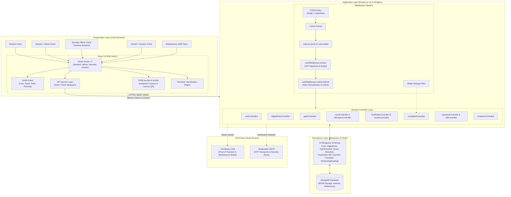
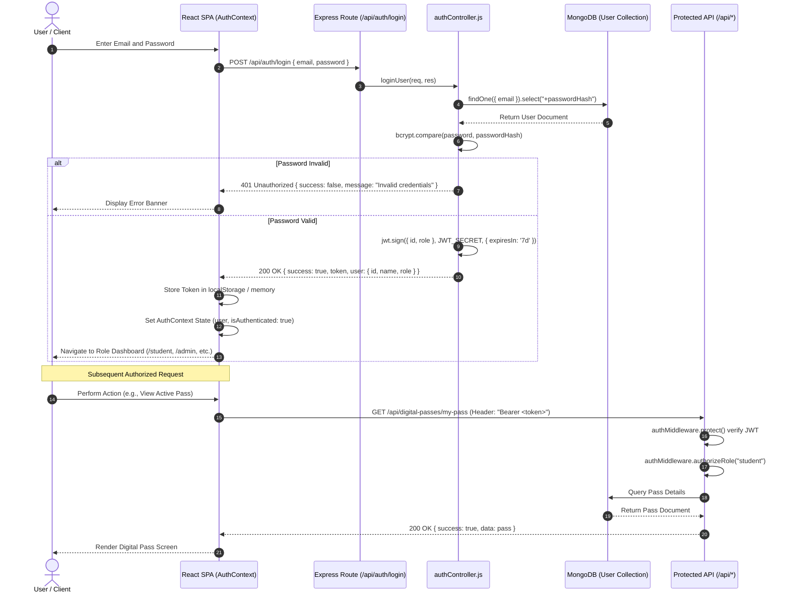
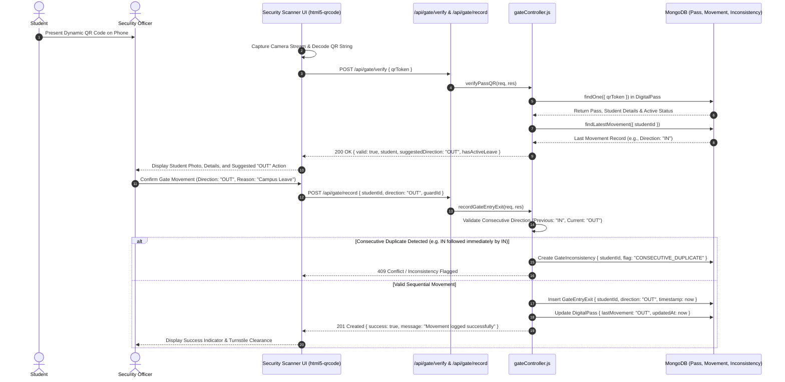
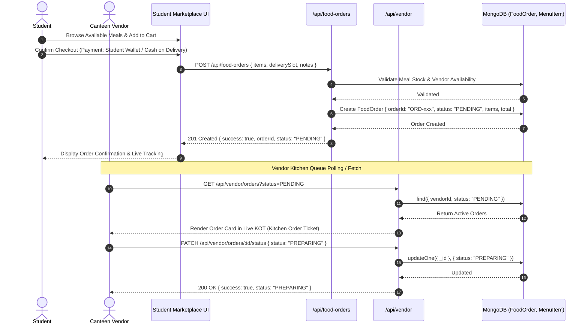

# 5. System Design and Architecture

## 5.1 Architecture Overview

The **SmartStay — Smart Hostel and Co-Living Management System** is architected as a modern, decoupled, multi-tier Client-Server Web Application. The system adheres to the Model-View-Controller (MVC) architectural pattern on the backend and a modular, component-driven Single Page Application (SPA) architecture on the frontend. Communication between the frontend presentation tier and the backend application tier is conducted entirely through stateless Representational State Transfer (REST) Application Programming Interfaces (APIs) utilizing JavaScript Object Notation (JSON) payloads.

```
+-----------------------------------------------------------------------------------+
|                                 PRESENTATION TIER                                 |
|   React 19 + Vite 8 SPA | Tailwind CSS v4 | Recharts | html5-qrcode | Lucide UI   |
+-----------------------------------------------------------------------------------+
                                          │
                                 HTTPS / REST JSON
                             (Bearer Token / Cookies)
                                          │
                                          ▼
+-----------------------------------------------------------------------------------+
|                                 APPLICATION TIER                                  |
|   Node.js v24 + Express.js v5.3.0 REST Server                                     |
|   ├── Middleware Pipeline (CORS, Cookie Parser, Protect, AuthorizeRole, Multer)  |
|   ├── Routing Layer (23 Modular Route Files, 132 Endpoints)                       |
|   └── Business Logic Controllers (19 Feature-Specific Domain Controllers)        |
+-----------------------------------------------------------------------------------+
                                          │
                                   Mongoose v9.11.2
                                   ODM Query Engine
                                          │
                                          ▼
+-----------------------------------------------------------------------------------+
|                                    DATA TIER                                      |
|   MongoDB Community / Atlas Database Engine                                       |
|   (24 Collections, Schema Validation, Compound Indexes, ObjectId Relations)       |
+-----------------------------------------------------------------------------------+
        │                                                                   │
        ▼                                                                   ▼
+───────────────────────────+                       +───────────────────────────────+
|   CLOUDINARY MEDIA CDN    |                       |   NODEMAILER SMTP GATEWAY     |
|   Image & Avatar Storage  |                       |   OTP & Email Notifications   |
+───────────────────────────+                       +───────────────────────────────+
```

### 5.1.1 Frontend Architecture
The frontend client is implemented as a client-side rendered (CSR) Single Page Application using **React 19.2.8** and bundled with **Vite 8.3.0**. The application structure follows a modular domain-driven organization:
1. **Routing Layer (`src/App.jsx`)**: Powered by `react-router-dom` (v7.18.4), providing client-side routing, route guard wrappers (`ProtectedRoute`, `PublicRoute`), and lazy loading of views across student, administrative, security, vendor, and maintenance domains.
2. **Context & State Management (`src/context/`)**: Centralized global application state is managed via React Context providers, specifically `AuthContext.jsx` for persistent authentication state, current user profile, token lifecycle, and role switching.
3. **Service Layer (`src/services/`)**: Encapsulates all backend HTTP network requests through dedicated service modules (`api.js`, `authApi.js`, `digitalPassApi.js`, `vendorApi.js`, `analyticsApi.js`, `complaintApi.js`, `paymentApi.js`, etc.). Requests configure base URLs, inject `Authorization: Bearer <token>` headers, and normalize error responses.
4. **Presentation Components (`src/components/` & `src/pages/`)**: Reusable UI primitives (buttons, modals, navigation sidebars, stat widgets, notification badges) and 36 domain-specific page views built using utility-first styling with **Tailwind CSS v4.3.3**.
5. **Hardware & Visual Integrations**: Integrates `html5-qrcode` (v2.3.8) for accessing client camera hardware via HTML5 WebRTC streams for QR scanning, `qrcode` (v1.5.4) for dynamic vector QR code synthesis, and `recharts` (v3.10.1) for responsive data visualisations.

### 5.1.2 Backend Architecture
The backend is built on **Node.js** executing an **Express.js v5.3.0** application server organized into a strict separation of concerns:
1. **HTTP Server & Entry Point (`server.js`)**: Configures environment variables (`dotenv`), cross-origin policies (`cors`), JSON body parsing (`express.json()`), cookie parsing (`cookie-parser`), static asset routes, and connects to the MongoDB database engine.
2. **Middleware Pipeline (`middleware/`)**:
   - `authMiddleware.js`: Intercepts inbound requests, extracts JWT tokens from Authorization headers or HTTP-only cookies, validates cryptographically using `jsonwebtoken`, verifies active account status, attaches the authenticated user document to `req.user`, and enforces Role-Based Access Control (`authorizeRole`).
   - `upload.js` / Multer middleware: Handles multipart/form-data for image uploads, file size limitations (5MB limit), and file format filtering before uploading to Cloudinary.
3. **Route Definitions (`routes/`)**: 23 distinct route files mapping RESTful URI paths to controller methods with role authorization guards.
4. **Controllers (`controllers/`)**: 19 controller modules that process incoming parameters, execute business logic rules (such as room occupancy recalculation, consecutive movement validation, QR signature verification, bill generation), and handle error boundaries.
5. **Data Access Layer (`models/`)**: 24 Mongoose schemas encapsulating field definitions, data validations, default values, pre-save hooks, and virtual populate definitions.

### 5.1.3 Database Architecture
The data persistence layer utilizes **MongoDB**, a schemaless document database, managed via **Mongoose Object Data Modeling (ODM) v9.11.2**.
- Documents are structured in BSON format, providing horizontal scalability and rapid JSON serialization.
- Relational integrity is maintained through explicit `mongoose.Schema.Types.ObjectId` references linking child documents to parent collections (e.g., `Allocation` references `User`, `Room`, and `Bed`; `GateEntryExit` references `User` and `DigitalPass`).
- Indexing strategies include unique indexes on user emails, registration numbers, digital pass tokens, room numbers within buildings, and compound indexes on date ranges and statuses for analytics performance.

### 5.1.4 Client-Server & REST API Communication
All client-server interactions adhere to strict REST conventions:
- **Statelessness**: Every request contains all necessary context and authentication credentials; no session state is maintained in server memory.
- **Resource Orientation**: Endpoints are structured around plural resource nouns (`/api/rooms`, `/api/digital-passes`, `/api/complaints`, `/api/food-orders`).
- **Standard HTTP Verbs**:
  - `GET`: Idempotent retrieval of resources or collections.
  - `POST`: Creation of subordinate resources, transactions, or token generation.
  - `PUT` / `PATCH`: Idempotent full or partial updates of existing entities.
  - `DELETE`: Safe removal or soft deletion of resources.
- **Uniform Response Envelope**: Responses follow a standardized JSON envelope structure:
  ```json
  {
    "success": true,
    "message": "Operation completed successfully.",
    "data": { ... },
    "count": 12
  }
  ```
  On operational failure, standard HTTP error codes (400, 401, 403, 404, 409, 500) are accompanied by:
  ```json
  {
    "success": false,
    "message": "Descriptive human-readable error explanation.",
    "error": "Internal error trace or validation breakdown"
  }
  ```

---

## 5.2 Technology Stack

The following table documents the exact dependencies, build tools, libraries, and runtime environments verified directly from `package.json`, `backend/package.json`, and `frontend/package.json`.

| Layer / Category | Technology / Package | Exact Version | Purpose & Architectural Role |
| :--- | :--- | :--- | :--- |
| **Runtime Environment** | Node.js | `>= 20.x` (Tested on `v24.19.0`) | Asynchronous event-driven JavaScript server runtime |
| **Server Framework** | Express.js | `^5.3.0` | Minimalist web application and REST routing framework |
| **Database Engine** | MongoDB | `>= 7.0` | High-performance document-oriented NoSQL database |
| **Object Data Modeling (ODM)** | Mongoose | `^9.11.2` | Schema modeling, validation, hooks, and query builder |
| **Authentication & Tokens** | jsonwebtoken | `^9.0.3` | HMAC-SHA256 stateless JSON Web Token issuance & verification |
| **Password Hashing** | bcryptjs | `^3.0.3` | Adaptive salted one-way password hashing (10 salt rounds) |
| **CORS Middleware** | cors | `^2.8.6` | Configures Cross-Origin Resource Sharing with credentials |
| **Cookie Parsing** | cookie-parser | `^1.4.7` | Parses cookie headers and populates `req.cookies` |
| **Environment Configuration** | dotenv | `^18.0.8` | Loads process environment variables from `.env` files |
| **File Upload Handling** | multer | `^2.5.0` | Multipart/form-data handler for receipt & avatar file uploads |
| **Cloud Media Storage** | cloudinary | `^2.11.0` | Cloud-hosted CDN storage for maintenance photos & receipts |
| **Email & OTP Delivery** | nodemailer | `^10.3.1` | SMTP email transport for OTP codes & official notifications |
| **Development Server (API)**| nodemon | `^3.1.14` | Hot-reloading development server for Node.js backend |
| **Frontend Framework** | React | `^19.2.8` | Declarative component-based UI library (React 19) |
| **Frontend DOM Engine** | React DOM | `^19.2.8` | React rendering engine for standard browser DOM |
| **Frontend Build Tool** | Vite | `^8.3.0` | Next-generation ES-module frontend build tool & dev server |
| **React Vite Plugin** | @vitejs/plugin-react | `^6.1.1` | Fast Refresh and Babel/SWC JSX transformation for React |
| **Client-Side Routing** | react-router-dom | `^7.18.4` | Declarative SPA navigation, nested routes, and route guards |
| **CSS Utility Framework** | Tailwind CSS | `^4.3.3` | Utility-first CSS engine with modern theme configuration |
| **Tailwind Vite Plugin** | @tailwindcss/vite | `^4.3.3` | Native lightning-fast Tailwind integration with Vite 8 |
| **Iconography** | lucide-react | `^1.48.0` | Comprehensive lightweight SVG icon library |
| **Data Visualisation** | recharts | `^3.10.1` | Declarative charting library for analytics dashboards |
| **QR Code Generation** | qrcode | `^1.5.4` | Vector & canvas client-side QR code generator for passes |
| **QR Code Camera Scanner** | html5-qrcode | `^2.3.8` | HTML5 WebRTC camera access & barcode/QR decoding engine |
| **Vector Animation** | lottie-web | `^5.13.0` | High-performance JSON animation renderer |
| **Interactive Icons** | @lordicon/element | `^3.0.2` | Web component player for animated Lordicon assets |
| **Code Linter** | ESLint | `^10.10.0` | Static code analysis tool for JavaScript and React JSX |

---

## 5.3 System Architecture Diagram

The diagram below illustrates the end-to-end component topology of SmartStay, tracing user interactions across browser clients, network middleware, server controllers, database collections, and third-party cloud services.



---

## 5.4 Data Flow and Sequence Diagrams

### 5.4.1 Authentication and Role-Based Session Flow
The sequence diagram below displays the user authentication sequence, JWT issuance, token storage, and subsequent RBAC verification.



### 5.4.2 Student Security, Digital Pass and Gate Movement Verification
The sequence diagram below details the gate movement workflow, including QR scanning, token verification, consecutive movement checks, and inconsistency logging.



### 5.4.3 Food Ordering and Live Kitchen Queue Synchronization
The sequence diagram illustrates how orders placed in the student marketplace propagate to the vendor live order queue.



---

## 5.5 Security Design

Security in SmartStay is implemented following the principle of **Defense in Depth**, spanning transport, network, authentication, authorization, and data validation layers.

```
+-----------------------------------------------------------------------------------+
| 1. TRANSPORT SECURITY: HTTPS / TLS 1.3 Encryption, HSTS Headers                   |
+-----------------------------------------------------------------------------------+
| 2. NETWORK & CORS: Whitelisted Origins, Credentials Allowed, Preflight Options    |
+-----------------------------------------------------------------------------------+
| 3. AUTHENTICATION: bcrypt (10 rounds), Stateless HMAC-SHA256 JWT (7-Day Expiry)   |
+-----------------------------------------------------------------------------------+
| 4. AUTHORIZATION: Strict RBAC with Role Normalization & Route Interceptors       |
+-----------------------------------------------------------------------------------+
| 5. INPUT SANITIZATION: Mongoose Schema Casting, Regex Validation, Type Enforcing   |
+-----------------------------------------------------------------------------------+
| 6. ASSET PROTECTION: Multer Filetype MIME Whitelist, 5MB Limits, Cloudinary CDN  |
+-----------------------------------------------------------------------------------+
```

### 5.5.1 Authentication Mechanism
- **Stateless Tokens**: The system utilizes JSON Web Tokens (`jsonwebtoken`) signed with a 256-bit cryptographic secret (`JWT_SECRET`) employing the HMAC-SHA256 algorithm.
- **Token Transmission**: Tokens are accepted either via the standard HTTP `Authorization` header (`Bearer <token>`) or parsed from HTTP-only cookies (`req.cookies.token`), preventing cross-site scripting (XSS) extraction in compliant browsers.
- **Token Verification**: Tokens verify cryptographic integrity, expiration timestamps (`exp`), and subject claims (`id`, `role`). If expired or tampered with, `jwt.verify` rejects the request with HTTP 401 Unauthorized.

### 5.5.2 Password Security and Hashing
- **Bcrypt Algorithm**: User passwords are never stored in plaintext. Passwords undergo irreversible one-way cryptographic hashing using `bcryptjs` with a work factor of **10 salt rounds**.
- **Schema Protection**: The `passwordHash` field in the Mongoose `User` schema is configured with `{ select: false }`, ensuring that standard queries (`find`, `findById`) omit the hash unless explicitly overridden during authentication.

### 5.5.3 Role-Based Access Control (RBAC) and Role Normalization
- **Role Hierarchy**: The system supports 9 operational roles: `student`, `admin` (hostel administrator / warden), `sub_warden`, `dean`, `security` (gate officer), `vendor` (cafeteria operator), `maintenance` (technician), `finance`, and `delivery`.
- **Role Normalization**: Implemented in `authMiddleware.js` (`normalizeRole`), sanitizing aliases (e.g., `hostel_admin` maps to `admin`, `security_officer` maps to `security`, `maintenance_staff` maps to `maintenance`).
- **Superuser Elevation**: Administrative accounts (`role: 'admin'`) possess superuser authorization across management endpoints, preventing lockout while enforcing strict isolation for operational roles.

### 5.5.4 Input Validation and Injection Prevention
- **NoSQL Injection Defense**: By relying on Mongoose typed schemas and parameterized query objects, raw strings are typecast and sanitized, preventing arbitrary MongoDB query selector injections (such as `{"$gt": ""}`).
- **MIME Type & File Size Guards**: File uploads (maintenance damage photos and bank payment receipts) pass through `multer` disk storage with strict MIME type filters (JPEG, PNG, WebP) and a hard cap of 5MB per file to prevent Denial of Service (DoS) through storage exhaustion.

### 5.5.5 Security Limitations and Hardening Opportunities
1. **JWT Revocation**: In the current implementation, JWTs are stateless without a Redis-backed token blacklist; a compromised token remains valid until its 7-day expiration unless the user's account status is set to `suspended` in the database.
2. **Rate Limiting**: The Express server currently lacks an express-rate-limit middleware; brute-force protection on the `/api/auth/login` endpoint is an identified future hardening target.
3. **Environment Secrets**: Development defaults exist as fallbacks (`smartstay_secret_change_later`); production deployments must strictly mandate strong cryptographically generated secrets via environment variables.

